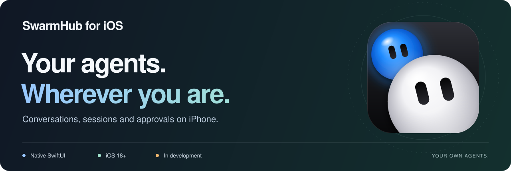
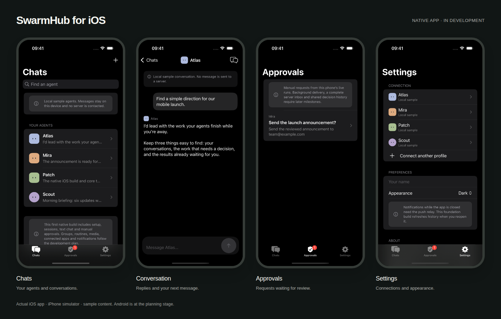

# SwarmHub for iOS

<picture>
  <source media="(max-width: 600px)" srcset="assets/readme-hero-mobile.svg">
  
</picture>

Chat with your agents, continue their server conversations, and review the actions that need your decision. A native **SwiftUI** app for iPhone, built in the same repository as SwarmHub for Mac.

> **In development.** The first native iOS build is available to run from source. TestFlight and App Store distribution are planned. Android is at the planning stage.

[Quick start](#quick-start) · [Screenshots](#a-look-inside) · [Current features](#what-you-can-do-today) · [Development plan](#whats-next) · [SwarmHub website](https://swarmhub.org/#mobile)

## A look inside

<picture>
  <source media="(prefers-color-scheme: light)" srcset="../../docs/ios/screenshots/mobile-light.png">
  
</picture>

Actual native app · iPhone 16 Pro simulator · sample content · dark and light appearances.

| Chats | Conversation | Approvals | Settings |
| --- | --- | --- | --- |
| Find your agents and open a conversation. | Read replies and write your next message. | Review manual requests from live turns. | Manage profiles and choose your appearance. |
| [Dark](../../docs/ios/screenshots/chats-dark.png) · [Light](../../docs/ios/screenshots/chats-light.png) | [Dark](../../docs/ios/screenshots/conversation-dark.png) · [Light](../../docs/ios/screenshots/conversation-light.png) | [Dark](../../docs/ios/screenshots/approvals-dark.png) · [Light](../../docs/ios/screenshots/approvals-light.png) | [Dark](../../docs/ios/screenshots/settings-dark.png) · [Light](../../docs/ios/screenshots/settings-light.png) |

[Capture details and reproduction](../../docs/ios/screenshots/SCREENSHOTS.md) · [37 interactive screen drawings for the full feature target](../../docs/ios/README.md)

## What you can do today

| Feature | In the native build |
| --- | --- |
| **Connect your agents** | Verify a Hermes server and add individual profiles. Profile checks prevent accidental access through another profile's key. |
| **Continue a conversation** | Choose an existing server session or start a new one. Opening the same session on Mac and iPhone uses the same server transcript. |
| **Chat in real time** | Stream text replies and use Stop when the server supports it. Interrupted turns stay unconfirmed until the server can report their outcome. |
| **Keep history and drafts** | Read cached conversations and retain unsent drafts in local SQLite storage. Full-text search and paged local history follow later. |
| **Review requested actions** | Approve once or decline manual requests from live turns. Decisions remain pending until the server acknowledges them. |
| **Explore before connecting** | Try local sample agents without a server or credentials. Choose dark, light or system appearance. |

The current iOS adapter supports **Hermes** with the `session_chat_streaming` capability. OpenClaw is available in the desktop app; its mobile adapter is planned. Groups, attachments, routines and the other features below are part of the mobile development plan.

## Quick start

You need a **Mac**, **Xcode with the iOS 18 SDK or newer**, and an installed iPhone simulator runtime to run the app. The deployment target is **iOS 18.0**. Python 3 is used to regenerate the project when building through the script.

```bash
git clone https://github.com/conrader/swarmhub.git
cd swarmhub
open Apps/iOS/SwarmHub.xcodeproj
```

1. Select the **SwarmHub** scheme and an installed iPhone simulator.
2. Press **Run** in Xcode.
3. Choose **Explore local sample agents** to inspect the app without connecting a server, or **Connect my server** to use Hermes.

For a physical iPhone, select your development team in **Signing & Capabilities**, then run on your device. The project contains no signing identity or team.

<details>
<summary><strong>Command-line builds and project generation</strong></summary>

Run these commands from the repository root:

```bash
# Unsigned Debug simulator app
./scripts/build-ios.sh

# Unsigned Release simulator app
SWARMHUB_IOS_CONFIGURATION=Release ./scripts/build-ios.sh

# Unsigned device build; install on a real iPhone through Xcode with signing
SWARMHUB_IOS_SDK=iphoneos \
  SWARMHUB_IOS_DESTINATION='generic/platform=iOS' \
  ./scripts/build-ios.sh
```

The Debug simulator app is written to `Apps/iOS/build/Build/Products/Debug-iphonesimulator/SwarmHub.app`. Compiling against the simulator SDK requires no installed runtime; launching the app does.

The checked-in Xcode project is generated with `python3 scripts/generate-ios-project.py`, using only the Python standard library. Run it after adding or removing source files; the build script also runs it automatically. Xcode resolves the repository-local `Packages/SwarmHubCore` dependency. No third-party iOS dependency is downloaded.

</details>

## Connect your Hermes server

1. Choose **Connect my server** and enter its **HTTPS address**, **profile name** and that profile's **key**. Choose **Test connection**.
2. Review the verified profile and choose **Add agent**. Testing saves no key or profile; adding the agent stores its key in iPhone Keychain. Add more profiles through Settings or the plus button in Chats.
3. Open an agent and choose an existing server conversation or create one. To continue a Mac conversation, choose the same server session.
4. Send a text message. The app streams the reply and caches its progress. If the connection drops, it checks the server before treating the turn as finished.

Your server must report `session_chat_streaming` for native chat. Reachable legacy Hermes servers can be verified but cannot chat in this build. Availability comes from reported capabilities and route results. Remote connections require HTTPS; `localhost` on an iPhone refers to the phone itself. Stock Hermes APIs are used, so no custom routes, patched agent or installed server skill are required.

<details>
<summary><strong>Credentials, approvals and interrupted work</strong></summary>

Credentials live in iPhone Keychain, separate from conversation snapshots. A default-profile key does not grant access to every profile. Sharing a server session shares its transcript; roster bindings, reactions and preferences are not yet synchronized between clients.

Approvals are manual. A request needs an exact, unredacted action and an offered `once` choice before it can be approved. A decision remains pending until the server acknowledges a nonzero resolved count. Uncertain delivery blocks another decision until an explicit status check. A complete pending-request inbox and cross-device audit are later milestones. Managed operations (P5d, in development) appear in a separate section only for boxes the operator switched to device-required mode and that you confirmed in Settings; they are signed with this phone's own approval key and never use the Hermes key.

Leaving the app closes its local stream without sending Stop. On reopening a known session, history and any cached run are checked. When the server cannot report an interrupted run, or the app never received its run ID, the outcome stays unconfirmed and the message is not automatically resent. Cached history remains readable. Notifications while the app is closed require the planned push relay.

</details>

## What's next

| Area | Planned work |
| --- | --- |
| **Conversations** | Threads, group chats, attachments, media, reactions and local search. |
| **Agent work** | Routines, models, remote computers, manager-agent controls and imports. |
| **Connected experiences** | Connected apps, demonstrations, voice and additional document formats. |
| **Mobile continuity** | Shared metadata, background notifications, deep links and cross-device approval history. |
| **Distribution and Android** | Device acceptance, accessibility checks, TestFlight, App Store release and a native Android target. |

The [iOS specsheet](../../docs/ios/specsheet.md) defines the full scope, backend dependencies and acceptance criteria. The [screen drawings](../../docs/ios/README.md) cover the broader target; they are design references. Android follows the same wire contract and fixtures, with its own native implementation and platform controls.

## Built in the same repository

| Location | Purpose |
| --- | --- |
| [Apps/iOS/Sources](Sources) | SwiftUI screens, navigation, Keychain, lifecycle handling and local demo. |
| [SwarmHub.xcodeproj](SwarmHub.xcodeproj) | The native iPhone project and **SwarmHub** scheme. |
| [Packages/SwarmHubCore](../../Packages/SwarmHubCore) | Foundation-only connection validation, Hermes APIs, streaming types and SQLite storage. |
| [docs/ios](../../docs/ios) | Specification, screen drawings, native captures and verification notes. |
| [Build script](../../scripts/build-ios.sh) · [Capture script](../../scripts/capture-ios-screenshots.sh) | Reproducible simulator builds and native screenshots. |

Android shares the wire contract and synthetic fixtures; it does not import this Swift-only package.

## Tests and verification

The first native build was compiled with **Xcode 27.0 / Swift 6.4** and launched on an **iPhone 16 Pro simulator running iOS 18.3**. Its initial shared-core verification passed **20 unit and real-HTTP fixture tests**. See the [verification record](../../docs/ios/native-verification.md) for results and remaining checks, including physical-device acceptance, Dynamic Type, VoiceOver, Keychain behavior and lifecycle transitions.

```bash
# Shared core plus the loopback HTTP/SSE fixture, on a Mac
./scripts/test-ios-core.sh

# Shared core unit tests; optional HTTP fixture tests are skipped
swift test --package-path Packages/SwarmHubCore

# Desktop regression suite, separately from the repository root
swift test
```

The HTTP fixture uses synthetic keys and conversations on `127.0.0.1`; it never contacts a personal server, writes to a real Keychain or starts an agent, model or tool. The test script stops the fixture when it finishes.

[Project README](../../README.md) · [Development specification](../../docs/ios/specsheet.md) · [Third-party notices](../../THIRD-PARTY-NOTICES.md) · [License](../../LICENSE)
