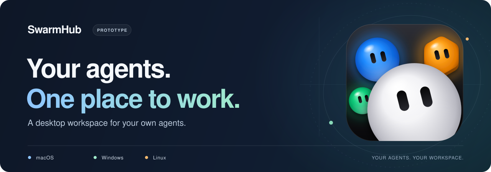

# SwarmHub

<picture>
  <source media="(max-width: 600px)" srcset="docs/readme/hero-mobile.svg">
  
</picture>

A desktop interface for your **Hermes** and **OpenClaw** agents. Keep conversations, recurring tasks, and approvals together in one place.

Hermes is supported now; OpenClaw integration is planned.

  
   
  A look inside the macOS prototype.

## Benefits

- Keep agent conversations and recurring work in one place.
- Spend less time repeating tasks by scheduling routines.
- Stay in control by reviewing requested actions.
- Use your own agents, server, and model choices.

## Features

- **Chat and threads:** streaming replies, threaded conversations, and stop controls.
- **Group chats:** multiple agents in one conversation, with `@mentions` to choose who responds.
- **Images and files:** share images, text files, PDFs and Word/RTF documents (read on your Mac, with on-device OCR for scans); find chat images and links in Media.
- **Routines:** schedule recurring tasks and receive their results in chat.
- **Agent overview:** see skills, tools, and available models.
- **Models per agent:** configure conversation and coding choices separately for each agent, such as Codex for conversation and Claude Code for coding. Conversation settings are available now; coding settings are planned.
- **Approvals:** approve or decline requests and set policies for each agent.
- **Agents that manage agents:** ask your main agent to create a new agent, change an agent's instructions or avatar, or retire one. It asks you first, and the new agent appears in the sidebar with its own key. Works with stock Hermes; nothing is installed on your server.
- **Sidebar and shortcuts:** every chat shows its latest message or your unsent draft; Navigate and Chat menus with keyboard shortcuts (Help → Keyboard Shortcuts).

Available features depend on what your connected server supports. See the [Hermes versions SwarmHub works with](docs/hermes-versions.md).

## Try SwarmHub

In development for **macOS, Windows, and Linux**. You can build the macOS prototype now; Windows and Linux versions are planned.

[Get started →](docs/guide.md#get-started)

[How it works](docs/guide.md#how-it-works) · [Technical reference](docs/reference.md) · [Roadmap](PLAN.md)

## Credits

Bot avatars use [BotAvatarsKit](https://github.com/Jakubantalik/Libraries.dev/tree/a27566557b4def79bcdcedc71858c0fb28020b6d/packages/bot-avatars/ports/ios/BotAvatarsKit) by **Jakub Antalik (Libraries.dev)**, licensed under [MIT](Vendor/BotAvatarsKit/LICENSE).

[Third-party notices](THIRD-PARTY-NOTICES.md) · [Project license](LICENSE)
