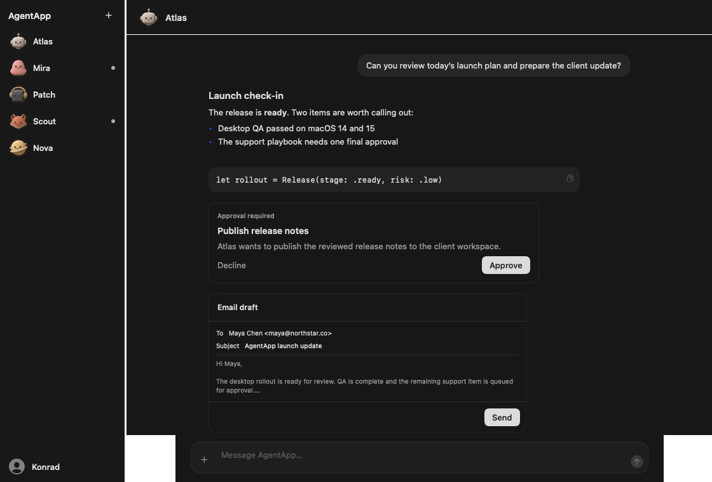

# AgentApp

A native macOS prototype for chatting with user-owned agent harnesses. There is no built-in model. The working name is defined once in `AppConstants.name` so it can be renamed later.

## Build and run

Requirements: macOS 14+, Xcode 16.2, Swift 6.

```bash
./scripts/build.sh
./scripts/run.sh
```

`scripts/build.sh` normally delegates to `swift build`. It also contains a direct Xcode 16.2 compiler fallback because the current host's `xcrun` crashes while loading `CoreDevice.framework`. The fallback was used to verify this prototype.

## What works

- A calm two-pane layout by default: a narrow material sidebar and a centred, 720-point chat column. The slim info pane opens from the bot name or with `Cmd+Shift+I`.
- Plain bot rows with 28-point static clay avatars, names, unread dots, subtle selection, a top add button, and a bottom account entry for Settings.
- Nine original PNG avatars are packaged as SwiftPM resources. Demo bots use them, and the bot editor includes an avatar picker.
- Assistant responses are unboxed text; user messages use a soft neutral bubble. Approval, email, option, and attachment content uses restrained bordered cards.
- A single rounded composer provides attach and send controls, Enter to send, and Shift+Enter for a newline.
- Create and edit bots with name, avatar, title, description, persona, and backend; bots and messages are saved atomically as JSON in Application Support.
- Fast `LazyVStack` chat rendering, native Markdown, code blocks, streaming updates, approvals, and backend cancellation support.
- The optional info pane contains the noVNC preview and opens it in a large sheet. noVNC is not exposed elsewhere.
- A backend-neutral `AgentBackend` protocol covering messages/events, sessions, cancellation, approvals, and connection tests.
- A working Mock backend with token streaming, progress, a sub-agent lifecycle, and a draft-before-send email approval.
- A Hermes SSE adapter, Bearer authentication, tool progress parsing, Keychain API-key storage, and a health check.
- Simple General, Computer, and Updates settings tabs cover appearance, notifications, backend endpoints/credentials, and noVNC configuration.

There are no external package dependencies.

## Hermes Agent setup

Verified against the public Hermes API-server documentation and repository plan on 2026-10-11:

- Enable the server with `API_SERVER_ENABLED=true` and set `API_SERVER_KEY` in `~/.hermes/.env`.
- Start it with `hermes gateway`; its documented default is `http://127.0.0.1:8642`.
- AgentApp defaults to `http://127.0.0.1:8642/v1` and sends `POST /v1/chat/completions` with `model: hermes-agent`, `stream: true`, and `Authorization: Bearer <key>`.
- Streaming uses OpenAI-compatible SSE chunks. The adapter also recognizes Hermes' `event: hermes.tool.progress` extension.
- Connection testing calls `/health`.

Sources: [Hermes API Server guide](https://hermes-agent.nousresearch.com/docs/user-guide/features/api-server), [Hermes API-server plan](https://github.com/hermes-agent-org/hermes/blob/main/.plans/openai-api-server.md).

Select **Hermes Agent** when editing a bot, then enter the base URL and key in Settings. Secrets are stored in macOS Keychain and never written to the repository or JSON store.

## OpenClaw status

OpenClaw is an explicit partial adapter. Its documented Gateway is a WebSocket RPC protocol—not an OpenAI-compatible HTTP endpoint—and uses `chat.send`, `chat.history`, `sessions.list`, plus event and approval families. URL configuration and the shared protocol boundary are present; authentication, request framing, event subscription, cancellation, and approvals remain to implement.

Sources: [Gateway protocol](https://docs.openclaw.ai/gateway/protocol), [WebChat methods](https://docs.openclaw.ai/web/webchat).

## Architecture

```text
Sources/AgentApp/
├── Models/       bot, message, approval, sub-agent and event types
├── Backends/     protocol plus Mock, Hermes and OpenClaw adapters
├── Stores/       app state, atomic local persistence and Keychain
└── Views/        sidebar, chat, composer, approvals, desktop and settings
```

JSON was chosen over SwiftData for this prototype to avoid a runtime/database dependency and keep startup small. Writes are atomic. For very large durable histories, the next storage iteration should use SQLite with indexed, paged message queries; the current lazy UI remains efficient, but decoding an entire JSON history is not the final 5,000-message storage design.

## Performance measurement

Measured on the supplied Mac with a clean process launch and the Xcode 16.2 compiler, using:

```bash
./scripts/build.sh
AGENTAPP_BENCHMARK=1 /usr/bin/time -l .build/debug/AgentApp
```

Current result after the simplification pass: **0.38 s for the first measured process launch**, **0.01 s for each of two immediately repeated warm launches**, and **12.0 MB peak resident memory at app initialization** (subsequent runs reported 11.9 MB). This benchmark exits immediately after app-state initialization; it does not claim first-frame timing. The app also prints initialization memory on normal launches.

## Screenshots




The managed session has no WindowServer/display access, so the repository includes a deterministic off-screen renderer for the actual SwiftUI hierarchy. Recreate both captures with:

```bash
AGENTAPP_APPEARANCE=Light AGENTAPP_SNAPSHOT="$PWD/docs/screenshot.png" .build/debug/AgentApp
AGENTAPP_APPEARANCE=Dark AGENTAPP_SNAPSHOT="$PWD/docs/screenshot-dark.png" .build/debug/AgentApp
```

The normal interactive app does not invoke this renderer.

## Next steps

1. Implement OpenClaw's authenticated WebSocket handshake and RPC/event mapping.
2. Upgrade Hermes from Chat Completions to its Runs API for reconnectable sessions, cancellation, and real approval resolution.
3. Move long histories to paged SQLite storage and add a repeatable 5,000-message scrolling benchmark.
4. Add attachment/image input, session switching, accessibility/UI tests, app signing, and a real app icon.
