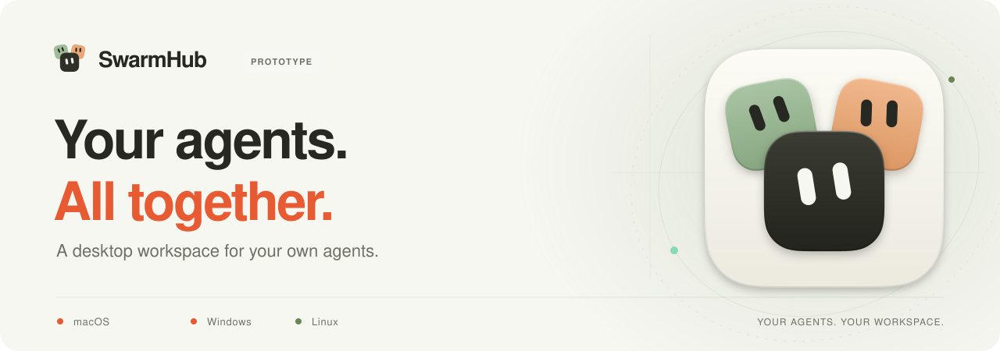

# SwarmHub

<picture>
  <source media="(max-width: 600px)" srcset="docs/readme/hero-mobile.svg">
  
</picture>

SwarmHub is a macOS app for chatting with agents that [Herdr Core](https://github.com/herdrdev/herdr-core) runs. Herdr Core runs agent programs such as Claude Code and Codex in terminals. A small service, the SwarmHub bridge (`HerdrWorkspace/`, the `swarmhub-herdr` binary), runs beside it, and the Mac app talks to that bridge. Herdr Core is the only backend.

## What the Mac app does

- **Chat with a bot.** Each bot is one agent on a Herdr server, started on its first message and reused while it runs. The reply shows as it is written, and each tool call shows as a step under it. You can stop an answer, send a message into a running answer (steer), and retry a message that was not sent.
- **Bots.** A bot has a name, an avatar, instructions, an agent program and a model. The agent programs and models offered are the ones the server lists.
- **Servers.** A server is this Mac, a machine reached over SSH (the app opens the port forward itself), or an address with an access key. Access keys are kept in the Keychain.
- **Main bot.** Each server has one main bot. It creates other bots, on its own decision or after asking you; any other bot that wants a new bot asks the main bot.
- **Helper agents.** A bot's agent can hand parts of its work to helpers. They show under the bot in the sidebar and open read-only. The server's helper settings decide what each difficulty runs on.
- **Bots write to each other.** A bot on a server can name another bot there and write to it. The app puts the message into that bot's chat, marked as passed on, and the answer back into the sender's chat, so you read both sides. Limits keep two bots from answering each other for ever, and a bot's settings can turn this off.
- **Projects on other servers.** Add the servers your projects live on to a Herdr server, name the folders on them as projects, and choose for each bot which projects it may use. The bot's agent can then run commands and change files in those folders ([how it works](HerdrWorkspace/README.md#work-on-projects-on-other-servers)).
- **Skills.** A server's skill library ([skillshare](HerdrWorkspace/README.md#manage-the-servers-skillshare-skills)) is listed in Settings and in a bot's Details, where each skill is turned on or off. The app does not install or remove skills.
- **Group chats.** Several bots in one thread; `@Name` sends a message to the named members, and a message without a mention goes to every member.
- **Attachments.** Images, text files and documents (PDF, RTF, DOC, DOCX). Text and document contents go to the agent as text; images stay in the chat and are not sent to the agent.
- **Dictation.** Record a message, have it transcribed through deAPI with your own key, and review the text before sending.
- **Import.** Bring bots and read-only history over from Grok Bot, or create a bot from a template file.
- **Sample agents.** Look around without a server; the sample agents answer locally.
- **Updates.** Installed builds update through Sparkle.

Details are in the [feature list](docs/FEATURES.md) and the [guide](docs/guide.md).

## Get started

1. Run Herdr Core and the bridge on the machine where the bots should work: [HerdrWorkspace/README.md](HerdrWorkspace/README.md#run-locally). The Mac app does not install or start them.
2. Start the app. [Download the latest macOS build](https://github.com/conrader/swarmhub/releases/latest), or build it on a Mac with Xcode:

   ```sh
   ./scripts/run.sh
   ```

3. The setup window opens while there is no bot. Choose where the bots run, press **Test**, then create the main bot. Its last step, which you can skip, adds a server your projects are on. [Setup in detail](HerdrWorkspace/README.md#use-the-mac-app).

The app needs macOS 14 or later.

## The browser workspace

The bridge also serves a browser interface to the same agents, with features the Mac app does not have (Library, Pages, routines, approvals, connected files). See [HerdrWorkspace/README.md](HerdrWorkspace/README.md) and the [feature plan](docs/herdr-workspace.md).

## Repository

| Path | What it is |
| --- | --- |
| `Sources/AgentApp`, `Tests/AgentAppTests` | The Mac app and its tests (`swift test` on a Mac). |
| `HerdrWorkspace/` | The bridge and the browser workspace (Rust). |
| `scripts/` | Build, run, packaging and update scripts for the Mac app, and the Grok Bot export tools. |
| `Resources/` | The app's Info.plist, entitlements, icons and avatars. |
| `Vendor/BotAvatarsKit` | The vendored avatar library. |
| `docs/` | Guide, reference, feature list, limits, changelog. |
| `Apps/iOS-seed` | Starting material for a future iPhone app: a few SwiftUI pieces, the app icon and screen drawings. It is not an app and does not build; see its [README](Apps/iOS-seed/README.md). |

## Docs

- [Guide](docs/guide.md): setup and everyday use.
- [Features](docs/FEATURES.md): what the Mac app does, by area.
- [Technical reference](docs/reference.md): build, files on disk, command-line flags, card syntax.
- [Limits](docs/ROADMAP-AND-LIMITS.md): what the Mac app does not do.
- [Automatic updates](docs/updates.md): signing key and release steps.
- [Changelog](docs/CHANGELOG.md).

## Credits

Bot avatars use [BotAvatarsKit](https://github.com/Jakubantalik/Libraries.dev/tree/a27566557b4def79bcdcedc71858c0fb28020b6d/packages/bot-avatars/ports/ios/BotAvatarsKit) by **Jakub Antalik (Libraries.dev)**, licensed under [MIT](Vendor/BotAvatarsKit/LICENSE).

[Third-party notices](THIRD-PARTY-NOTICES.md) · [Project license](LICENSE)
