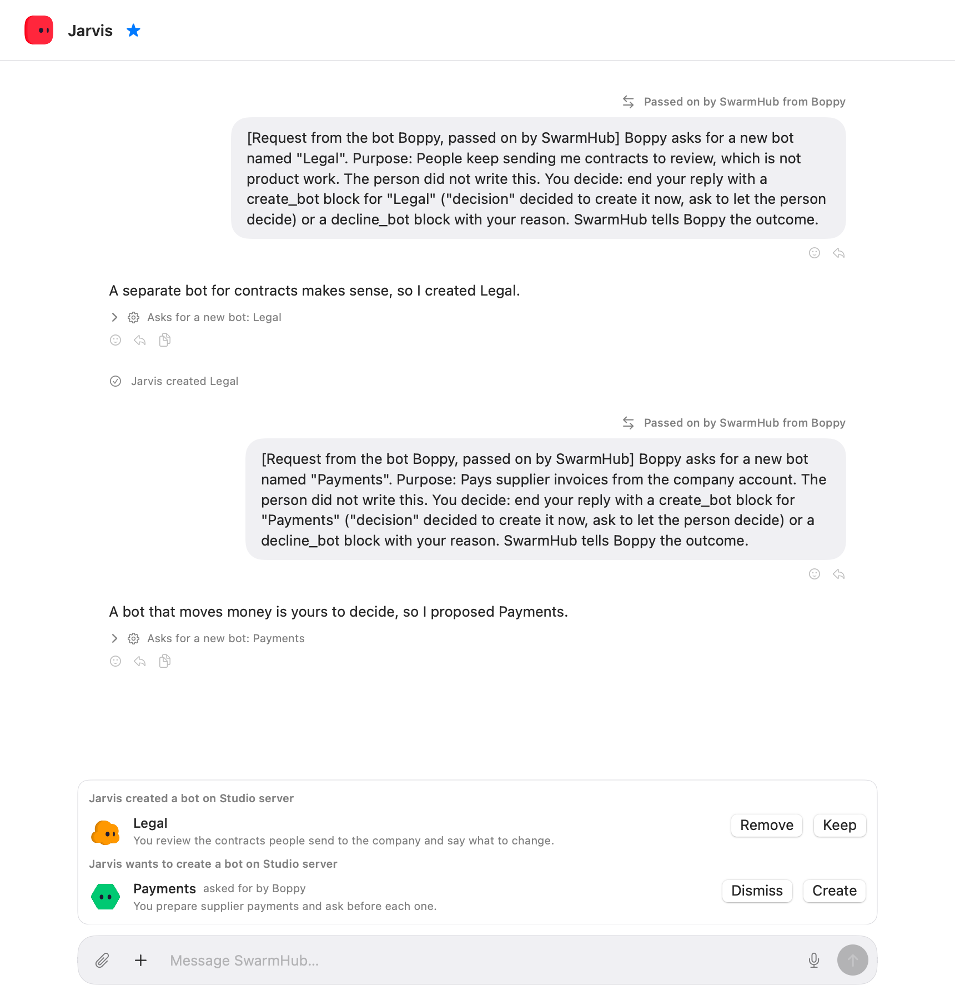
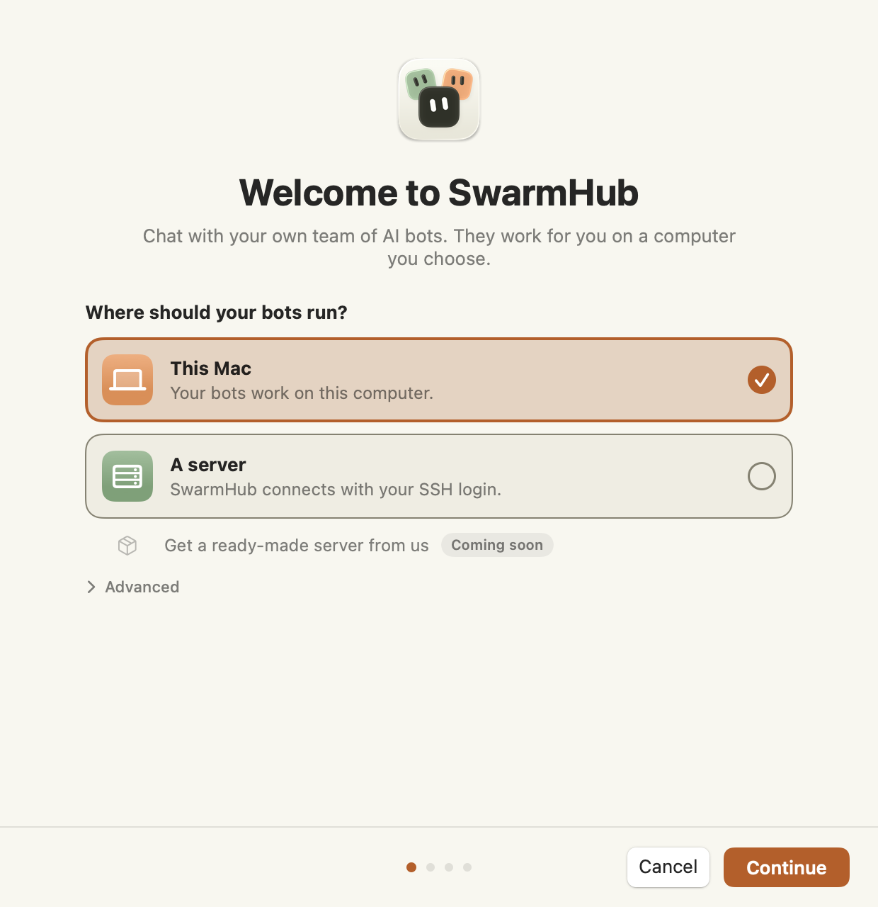
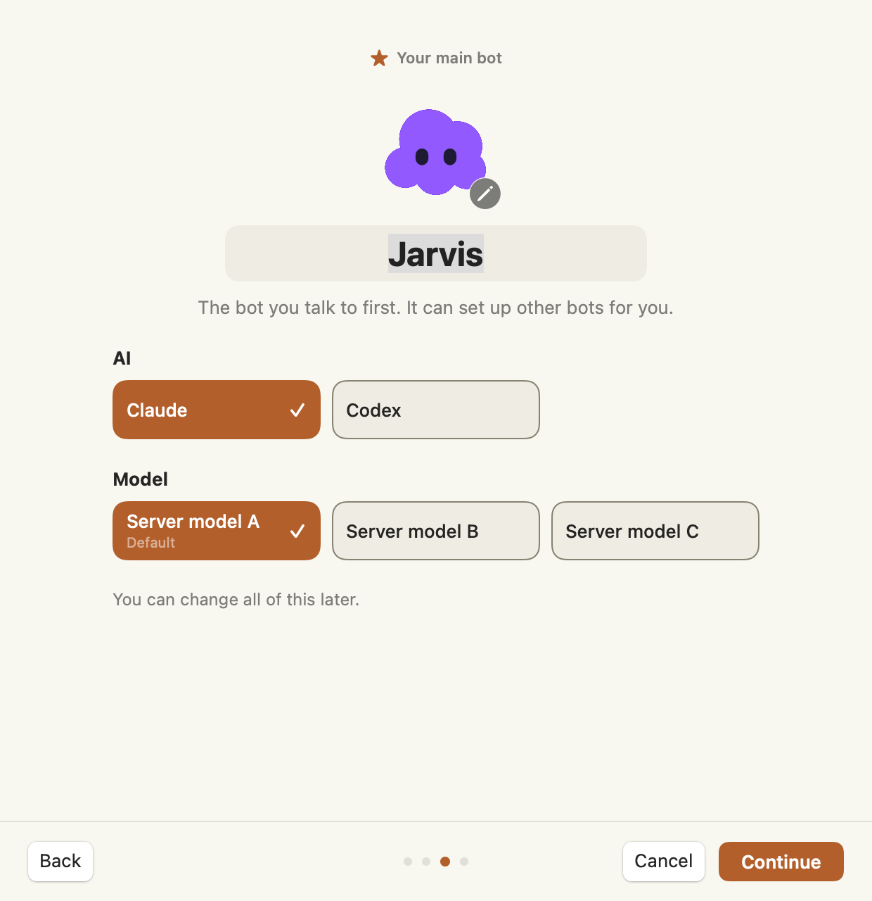

# SwarmHub

<picture>
  <source media="(max-width: 600px)" srcset="docs/readme/hero-mobile.svg">
  
</picture>

SwarmHub is a native Mac app for working with a team of bots. Each bot is a real agent program, such as Claude Code or Codex, that runs in a terminal on a computer you choose: this Mac or your own server. You chat with a bot; it reads files, runs commands and writes code there, and you watch its reply and its tool steps as they happen. In the app, the agent program is the bot's **AI** and goes by its short name: "Claude", "Codex".

The terminals are run by [Herdr Core](https://github.com/herdrdev/herdr-core), a separate open-source project. SwarmHub adds two things: the Mac app in this repository, and a small service that runs beside Herdr Core, the SwarmHub bridge (`HerdrWorkspace/`, the `swarmhub-herdr` binary). SwarmHub calls no model itself. Each agent program uses its own sign-in.

This is early software. What it does not do is listed under [Status](#status) and in [Limits](docs/ROADMAP-AND-LIMITS.md).

<p align="center">
  <picture>
    <source media="(prefers-color-scheme: dark)" srcset="docs/screenshots/dark/chat-main-bot.png">
    
  </picture>
</p>
<p align="center"><sub>The main bot's chat. Every screen on this page is rendered by the app itself with sample content.</sub></p>

## How it works

<picture>
  <source media="(prefers-color-scheme: dark)" srcset="docs/diagrams/overview-dark.svg">
  
</picture>

1. **You write to a bot.** The Mac app sends the message to the bridge over HTTP, with the server's access key. The bridge answers on its own machine only, so a server is reached through an SSH port forward, which the app can open itself.
2. **The bridge hands it to Herdr Core,** which types it into the bot's agent: a terminal running Claude Code, Codex or another agent program. If the bot has no agent yet, one is started first, with the bot's instructions.
3. **The agent works.** Hooks that the bridge gave the agent program report each tool call and, for Codex and for Claude Code templates that turn it on, the reply so far. The app follows them on one events connection and shows the reply as it is written, with the tool calls as steps under it.
4. **The reply is saved** by the agent program's own Stop hook when the turn ends, and the bridge sends it to the app.

A message you send while the agent answers goes into the running answer (steer). **Stop** presses the agent's own interrupt key.

The full picture, with the message flow, the security boundaries and a map of the code, is in [Architecture](docs/architecture.md).

## What you can do

- **Choose where bots run.** This Mac, or a server the app reaches with your SSH login. A server by address and access key is under **Advanced**. The setup window checks the connection and says what is wrong when it fails.
- **Keep a team of bots.** A bot has a name, an avatar, instructions, an AI and a model. The AIs and models offered are the ones your server lists; the app keeps no list of its own.
- **Let the main bot build the team.** Each server has one main bot, marked with a star. It creates other bots, at once or after asking you. Any other bot that wants a new bot asks the main bot.
- **Tell your bots about yourself once.** A new main bot opens the conversation: it says hello and asks a few short questions, each of which you can skip. What it learns is kept as **About you**, a short text every bot reads. Nothing is added without your OK, and you can edit it in **Settings → General**.
- **Have bots write to each other.** A bot names another bot and writes to it; the app passes the message on and the answer back, and both chats show everything. Fixed limits stop two bots from going on by themselves.
- **Hand work to helpers.** A bot can start short-lived helpers for parts of its work. The server's settings decide which AI and model each difficulty runs on; the bot cannot choose. Helpers show under the bot and open read-only.
- **Work on projects on other servers.** Add the servers your projects live on, name folders on them as projects, and choose for each bot which it may use.
- **Share skills.** A server's library of skills, agents, MCP servers, plugins and hooks ([skillshare](https://skillshare.runkids.cc)) is managed in the app: sync it, switch things on and off, install skills from a repository after a security check, update and remove them.
- **Keep everything up to date.** **Settings → Software Update** shows the app, which updates through Sparkle, and for each server the version of the bridge (the app calls it the workspace) and of Herdr Core, with one button when something is behind. See [Updates](docs/updates.md).
- **Also in the app:** group chats with `@Name`, attachments (documents are sent as text), import from Grok Bot, sample bots that answer locally.

Details: [Features](docs/FEATURES.md).

## Quick start

You need a Mac with macOS 14 or later, and Herdr Core with at least one agent program (Claude Code or Codex) on the computer where the bots should work.

1. **Start Herdr Core and the bridge** on that computer: [Run locally](HerdrWorkspace/README.md#run-locally). The Mac app does not install or start them.
2. **Build and start the app** from this checkout, on a Mac with Xcode:

   ```sh
   ./scripts/run.sh
   ```

3. **Follow the setup window.** It opens while there is no bot.

   | Step | What you do |
   | --- | --- |
   | Where | Choose **This Mac** or **A server**. A server by address and access key is under **Advanced**. |
   | Connect | This Mac is checked at once. For a server, give its name and press **Connect**; the app opens the SSH connection and reads the access key itself. |
   | Main bot | Give it a name, an avatar, an AI and a model. |
   | More bots | Optional: a bot for each other AI the server has. |
   | Projects | Optional: add a server your projects are on. |

   The window ends in the main bot's chat, where the main bot says hello and asks a few questions about you.

To look around without a server, close the setup window and choose **Look around with sample bots** in the main window.

> [!NOTE]
> The packaged build is on the [releases page](https://github.com/conrader/swarmhub/releases). From 0.8.0 on it is the app this README describes; bots from earlier versions do not carry over. On this Mac the app installs what bots need (Herdr Core and the SwarmHub service) when you choose **This Mac**; on a server they are installed by hand the first time: see the [guide](docs/guide.md).

More: the [guide](docs/guide.md).

## Screens

Rendered by the app (`AgentApp --render-setup`) with sample content. No real server, name or key appears in them.

<table>
  <tr>
    <td width="50%" valign="top">
      <picture>
        <source media="(prefers-color-scheme: dark)" srcset="docs/screenshots/dark/setup-where.png">
        
      </picture>
      <br><sub>The setup window: where bots run.</sub>
    </td>
    <td width="50%" valign="top">
      <picture>
        <source media="(prefers-color-scheme: dark)" srcset="docs/screenshots/dark/setup-main-bot.png">
        
      </picture>
      <br><sub>The main bot, its AI and its model.</sub>
    </td>
  </tr>
  <tr>
    <td width="50%" valign="top">
      <picture>
        <source media="(prefers-color-scheme: dark)" srcset="docs/screenshots/dark/helper-view.png">
        
      </picture>
      <br><sub>A helper, opened read-only.</sub>
    </td>
    <td width="50%" valign="top">
      <picture>
        <source media="(prefers-color-scheme: dark)" srcset="docs/screenshots/dark/projects.png">
        
      </picture>
      <br><sub>Project servers and projects.</sub>
    </td>
  </tr>
</table>

<p align="center">
  <picture>
    <source media="(prefers-color-scheme: dark)" srcset="docs/screenshots/dark/chat-steps.png">
    
  </picture>
</p>
<p align="center"><sub>While the bot works, the chat names the step it is on.</sub></p>

## Documentation

| | |
| --- | --- |
| [Guide](docs/guide.md) | Setup and everyday use. |
| [Architecture](docs/architecture.md) | The pieces, how a message travels, what is enforced in code, the security boundaries, where the code is. |
| [The bridge's manual](HerdrWorkspace/README.md) | Running the bridge, its HTTP API, agent templates, helpers, projects, the browser workspace. |
| [How bots communicate](docs/bot-communication.md) | The behaviour SwarmHub is being built towards. A specification: [what exists today](docs/architecture.md#communication-the-target-and-today). |
| [Approvals](docs/approvals.md) | A second specification, mostly not built yet. |
| [Features](docs/FEATURES.md) · [Limits](docs/ROADMAP-AND-LIMITS.md) | What the Mac app does, and what it does not. |
| [Technical reference](docs/reference.md) | Build, files on disk, command-line flags, card syntax. |
| [Updates](docs/updates.md) | Software Update, how a server updates itself, what is trusted, release steps. |
| [Changelog](docs/CHANGELOG.md) | History. |

## Status

- The Mac app is the only app. There is no iPhone, Windows, Linux or Android app. The bridge also serves a [browser workspace](HerdrWorkspace/README.md) to the same agents, with features the Mac app does not have (a Library, Pages, routines, approvals, connected files).
- The app does not install Herdr Core, the bridge or an agent program. Once a bridge that can update itself is installed, the app updates it ([Updates](docs/updates.md)). "Get a ready-made server from us" in the setup window is marked "Coming soon": it is planned, and nothing is behind it yet.
- All agents on a server run as one account. The per-bot choices (projects, helpers) are bookkeeping, not isolation: see [Trust and security](docs/architecture.md#trust-and-security).
- Bots pass messages to each other only while the Mac app runs, because the app does the passing on.
- Most of [How bots communicate](docs/bot-communication.md) (kinds of messages, time limits, initiative, planned check-ins) and of [Approvals](docs/approvals.md) is not built.
- An agent gets text only. An attached image stays in the chat.

## Repository

| Path | What it is |
| --- | --- |
| `Sources/AgentApp`, `Tests/AgentAppTests` | The Mac app (Swift, SwiftUI) and its tests (`swift test` on a Mac). |
| `HerdrWorkspace/` | The bridge and the browser workspace (Rust). |
| `scripts/` | Build, run, packaging and release scripts for the Mac app and the bridge, and the Grok Bot export tools. |
| `Resources/` | The app's Info.plist, entitlements, icons and avatars. |
| `Vendor/BotAvatarsKit` | The vendored avatar library. |
| `docs/` | Guide, architecture, reference, feature list, limits, changelog; the diagrams and screens on this page. |
| `Apps/iOS-seed` | Starting material for a possible iPhone app. It is not an app and does not build; see its [README](Apps/iOS-seed/README.md). |

## Credits

Bot avatars use [BotAvatarsKit](https://github.com/Jakubantalik/Libraries.dev/tree/a27566557b4def79bcdcedc71858c0fb28020b6d/packages/bot-avatars/ports/ios/BotAvatarsKit) by **Jakub Antalik (Libraries.dev)**, licensed under [MIT](Vendor/BotAvatarsKit/LICENSE).

[Third-party notices](THIRD-PARTY-NOTICES.md) · [Project license](LICENSE)
