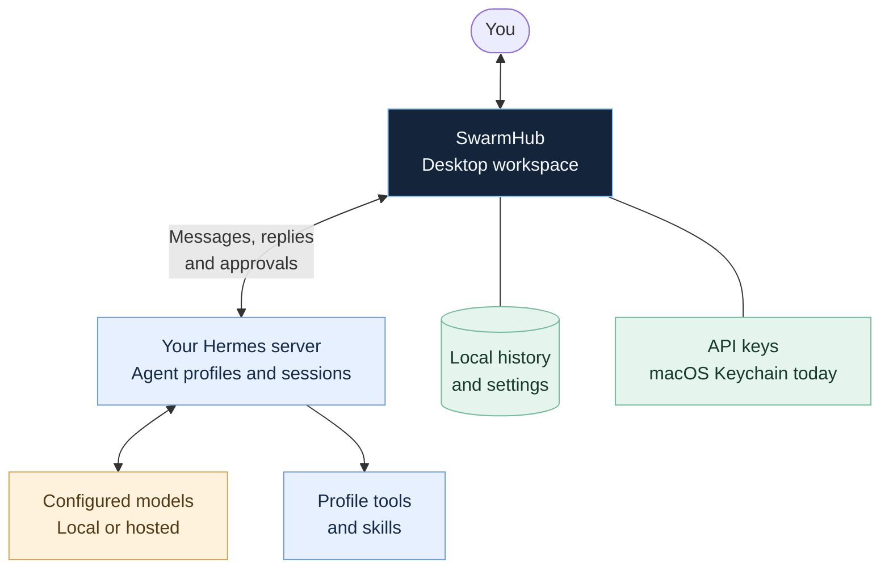
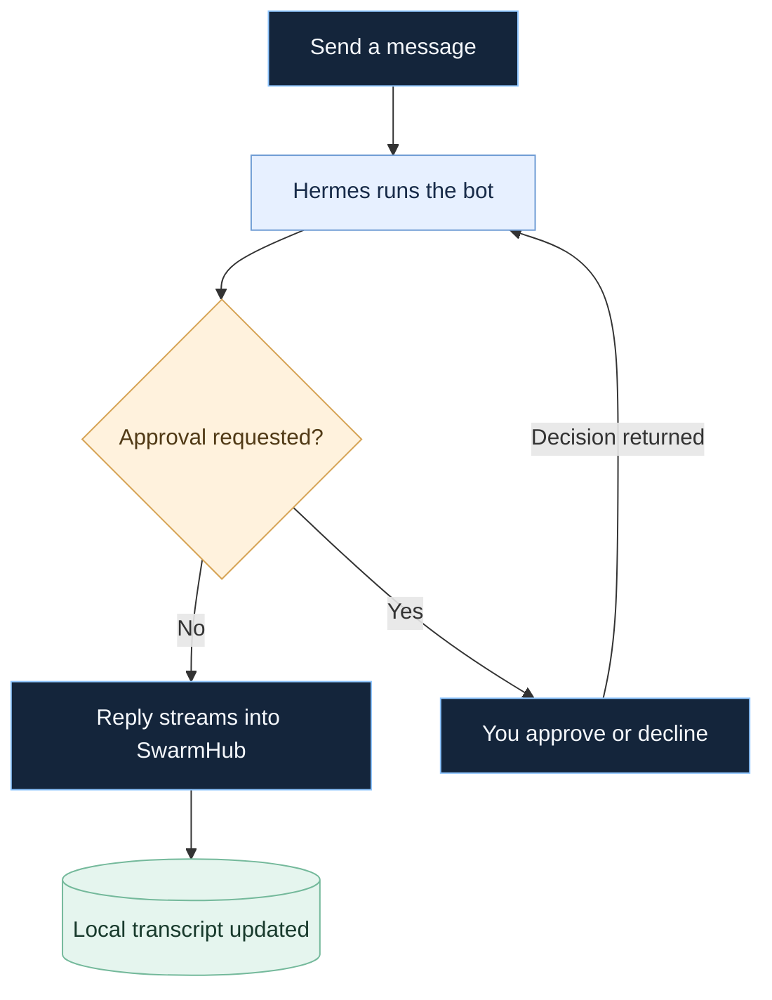

# SwarmHub

<picture>
  <source media="(max-width: 600px)" srcset="docs/readme/hero-mobile.svg">
  
</picture>

<p align="center">
  <a href="#get-started">Get started</a> &nbsp;·&nbsp;
  <a href="#how-it-works">How it works</a> &nbsp;·&nbsp;
  <a href="#what-you-can-do">Features</a> &nbsp;·&nbsp;
  <a href="docs/reference.md">Technical reference</a> &nbsp;·&nbsp;
  <a href="PLAN.md">Roadmap</a>
</p>

SwarmHub brings your **Hermes agents** into one desktop workspace: conversations in the middle, bots on the left, and tools and context on the right. Your own server runs the agents and models; SwarmHub is the workspace you use to talk to them.

SwarmHub is being built for **macOS, Windows, and Linux**. This repository currently contains the native macOS prototype.

<p align="center">
  
  <br>
  <sub>Demo snapshot from the app’s SwiftUI views, with the earlier classic avatars. <a href="docs/reference.md#screenshots">Recreate the capture →</a></sub>
</p>

## What you can do

| Feature | In the workspace |
|:--|:--|
| **Chat** | Stream replies, stop a run, steer supported runs, and fork replies into threads. |
| **Bring bots together** | Create group chats and use `@mentions` to choose who responds. |
| **Share context** | Attach images and text files; use draft cards, choice cards, and a searchable imported history archive. |
| **Inspect your agents** | See each profile’s skills, tools, and models; collect chat images and links in Media. |
| **Run routines** | Create and manage Hermes jobs, with completed results delivered into the chat. |
| **Stay in control** | Review approval requests, choose per-bot policies, and open a configured remote desktop. |

Dark, light, and system appearance. Keyboard shortcuts. Local chat history. The current macOS build stores API keys in Keychain. Server features appear when the connected profile supports them.

## How it works

SwarmHub is the desktop workspace. Your Hermes server runs the agents, connects to configured models, and provides each profile’s tools and skills.



### From message to reply

With the default **Ask me** policy, approval requests come to you in SwarmHub. Approved operations can proceed; declined operations are denied.



## Get started

To run the current macOS prototype, you’ll need **macOS 14+**, **Xcode 16.2**, and **Swift 6**. In Terminal on your Mac:

```bash
git clone https://github.com/conrader/swarmhub.git
cd swarmhub
./scripts/run.sh
```

The run script builds and launches the app.

### Connect Hermes

1. Open **Settings → Account** and enter your Hermes server’s base URL and API key.
2. Use **Test & Discover** to check the connection.
3. For named profiles, use **Add bots from box** with one `profile=key` per line. Each profile needs its own key.

Need to set up the server first? Follow the [Hermes setup notes](docs/reference.md#hermes-agent-setup). For imports, see [Grok Bot history](docs/reference.md#feature-parity) and [bot templates](docs/reference.md#grok-bot-template-import).

### macOS shortcuts

| Shortcut | Action |
|:--|:--|
| `⌘ K` | Open the quick switcher |
| `⌘ N` | Create a bot |
| `⌃ ⌘ S` | Toggle the sidebar |
| `⇧ ⌘ I` | Toggle the info panel |

## Project status

**This is a prototype.** Windows and Linux versions are planned. Hermes is the implemented backend; OpenClaw currently has configuration and an adapter boundary, with its WebSocket transport still to come. PDF and document attachments, more reliable recovery of interrupted turns, and coding threads are planned.

Approvals default to **Ask me**. Rules and reviewer modes have known limitations, and provider-backed reviewer decisions remain unverified. Read the [known issues](docs/reference.md#known-issues) before enabling automatic approvals.

The [roadmap](PLAN.md) and [phase briefs](briefs/) track the work ahead. The [technical reference](docs/reference.md) documents feature behavior, compatibility, and verification limits.

## Build & contribute

```bash
./scripts/build.sh   # Build the app
swift test           # Run the test suite on a Mac
```

The build script includes a direct-compiler fallback for the documented Xcode 16.2 toolchain issue; that fallback does not run tests. See the [build notes](docs/reference.md#build-and-run) for details.

The current macOS implementation uses SwiftUI, atomic JSON persistence, and backend adapters under `Sources/AgentApp/`. The Swift package and executable retain the `AgentApp` codename. See [architecture](docs/reference.md#architecture), [integration notes](docs/hermes-integration.md), and the [project constraints](PLAN.md#standing-constraints-from-briefmd-and-spec-61).

---

[MIT license](LICENSE) · Bot marks by [Jakub Antalik’s BotAvatarsKit](https://github.com/Jakubantalik/Libraries.dev/tree/main/packages/bot-avatars), vendored under MIT. [Third-party notices](THIRD-PARTY-NOTICES.md).
