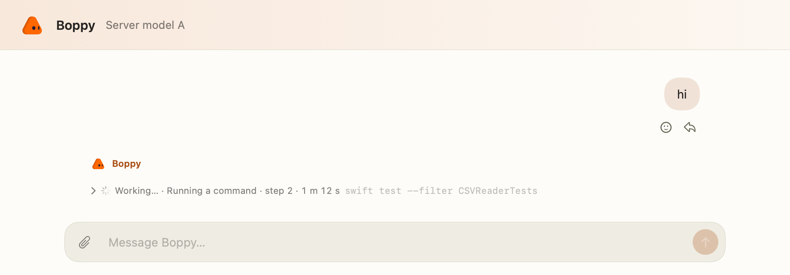
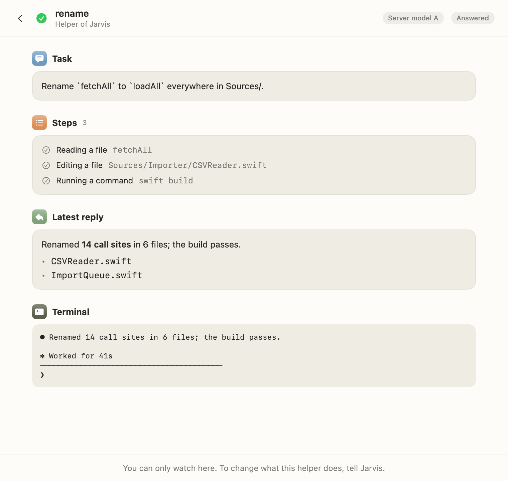
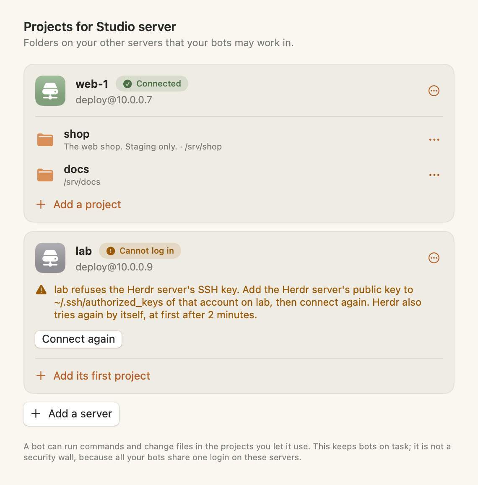

# SwarmHub

**Bring your Grok bot to your Mac and choose the model it runs on.** Start with one assistant on your Mac or your server, then add a bot when you have a job for it. Use Codex, Claude Code, both, or your own API provider through OpenCode. Google's Gemini CLI can run a bot too, in beta. Each bot can use **Recommended** or a model you pick.

[Mac releases](https://github.com/conrader/swarmhub/releases) · [Try the sample](#try-the-sample) · [Set up a real bot](#quick-start)

<picture>
  <source media="(prefers-color-scheme: dark)" srcset="docs/screenshots/dark/chat-steps.png">
  
</picture>

### Try the sample

On a fresh install, close the setup window and choose **Look around with sample bots** in the main window. Patch opens with three changes and a finished release-note draft. Expand **Jarvis** to inspect its **tests** and **rename** sessions. The example is stored locally and uses no model quota. In a new real bot’s chat, choose **Draft release notes** for the same editable input. Compare the answer with [the sample output](docs/guide.md#release-notes-example).

### Switching from Grok Bot

Choose **Bring my Grok bot**, select a bot, and review the available history. You can import recent messages from the local cache. The archive stays readable on your Mac. The bot’s new agent gets the imported bot’s instructions and reads the imported conversation before its first reply, so it can carry on; a long conversation is summarised first.

## How it works

<picture>
  <source media="(prefers-color-scheme: dark)" srcset="docs/diagrams/overview-dark.svg">
  
</picture>

1. **You write to a bot.** The Mac app sends the message to the bridge over HTTP, with the server's access key. The bridge answers on its own machine only, so a server is reached through an SSH port forward, which the app can open itself.
2. **The bridge hands it to Herdr Core,** which types it into the bot's agent: a terminal running Claude Code, Codex or another agent program. If the bot has no agent yet, one is started first, with the bot's instructions.
3. **The agent works.** Hooks that the bridge gave the agent program report each tool call and, for Codex and for Claude Code templates that turn it on, the reply so far. The app follows them on one events connection and shows the reply as it is written, with the tool calls as steps under it.
4. **The reply is saved** by the agent program's own Stop hook when the turn ends, and the bridge sends it to the app.

A message you send while the agent answers goes into the running answer (steer). **Stop** presses the agent's own interrupt key.

The full picture, with the message flow, the security boundaries and a map of the code, is in [Architecture](docs/architecture.md).

## What you can do

- **Finish a task in Mac chat.** Review a permission request, answer a terminal prompt, and open the files or Pages published with the reply.
- **Choose where bots run.** This Mac, or a server the app reaches with your SSH login. A server by address and access key is under **Advanced**. The setup window checks the connection and says what is wrong when it fails.
- **Keep a team of bots.** A bot has a name, an avatar, instructions, an AI and a model. The AIs and models offered are the ones your server lists; the app keeps no list of its own.
- **Let the main bot build the team.** Each server has one main bot, marked with a star. It creates other bots, at once or after asking you. Any other bot that wants a new bot asks the main bot.
- **Tell your bots about yourself once.** Use **Get to know me** to start an optional introduction. What it learns is kept as **About you**, a short text every bot reads. Nothing is added without your OK, and you can edit it in **Settings → General**.
- **Have bots write to each other.** A bot names another bot and writes to it; the app passes the message on and the answer back, and both chats show everything. Fixed limits stop two bots from going on by themselves.
- **Hand work to helpers.** A bot can start short-lived helpers for parts of its work. Choose a coding model for each bot’s helpers or use the server’s defaults by task difficulty. Helpers show under the bot and open read-only.
- **Work on projects on other servers.** Add the servers your projects live on, name folders on them as projects, and choose for each bot which it may use.
- **Share skills.** A server's library of skills, agents, MCP servers, plugins and hooks ([skillshare](https://skillshare.runkids.cc)) is managed in the app: sync it, switch things on and off, install skills from a repository after a security check, update and remove them.
- **Keep everything up to date.** **Settings → Software Update** shows the app, which updates through Sparkle, and for each server the version of the bridge (the app calls it the workspace) and of Herdr Core, with one button when something is behind. See [Updates](docs/updates.md).
- **Also in the app:** group chats with `@Name`, attachments (documents are sent as text), import from Grok Bot, sample bots that answer locally.

Details: [Features](docs/FEATURES.md).

## Quick start

The native app requires macOS 14 or later. Check the version on the [releases page](https://github.com/conrader/swarmhub/releases). The Herdr-based app starts at 0.8.0. The new welcome screen and run summaries described here are in this checkout.

1. Open the packaged app, or run `./scripts/run.sh` from this checkout on a Mac with Xcode.
2. Choose **Codex**, **Claude Code**, **Both**, or **API provider**, then **Set up on this Mac**. For Codex, Recommended prefers Sol, then Terra. With Claude Code, it prefers Sonnet. For API access, connect OpenRouter or another provider in OpenCode and use its configured default or choose a listed model such as DeepSeek or Qwen. **Set Up This Mac** installs Herdr Core and the SwarmHub service if needed. For a remote machine, use the [server setup guide](docs/guide.md#get-started).
3. Review the bot and model. Create the bot to open its chat immediately, or use **More options** for project setup when available. Choosing Both creates one main bot. Add another later for a specific task.
4. Choose **Draft release notes**, edit the changes, and press Send. The finished reply shows elapsed time, observed tool calls, and the launch model when the server reports it. Your agent provider handles billing.

## Screens

Rendered by the app (`AgentApp --render-setup`) with sample content. No real server, name or key appears in them.

<table>
  <tr>
    <td width="50%" valign="top">
      <picture>
        <source media="(prefers-color-scheme: dark)" srcset="docs/screenshots/dark/setup-where.png">
        
      </picture>
       The setup window: where bots run.
    </td>
    <td width="50%" valign="top">
      <picture>
        <source media="(prefers-color-scheme: dark)" srcset="docs/screenshots/dark/setup-main-bot.png">
        
      </picture>
       The main bot, its AI and its model.
    </td>
  </tr>
  <tr>
    <td width="50%" valign="top">
      <picture>
        <source media="(prefers-color-scheme: dark)" srcset="docs/screenshots/dark/helper-view.png">
        
      </picture>
       A helper, opened read-only.
    </td>
    <td width="50%" valign="top">
      <picture>
        <source media="(prefers-color-scheme: dark)" srcset="docs/screenshots/dark/projects.png">
        
      </picture>
       Project servers and projects.
    </td>
  </tr>
</table>

  <picture>
    <source media="(prefers-color-scheme: dark)" srcset="docs/screenshots/dark/chat-steps.png">
    
  </picture>

While the bot works, the chat names the step it is on.

## Documentation

| | |
| --- | --- |
| [Agent QA on Mac](docs/agent-qa.md) | Drive a sample workspace, explore UI behavior, and replay findings with screenshots. |
| [Guide](docs/guide.md) | Setup and everyday use. |
| [Architecture](docs/architecture.md) | The pieces, how a message travels, what is enforced in code, the security boundaries, where the code is. |
| [The bridge's manual](HerdrWorkspace/README.md) | Running the bridge, its HTTP API, agent templates, helpers, projects, the browser workspace. |
| [How bots communicate](docs/bot-communication.md) | Server-side handoffs, check-ins, limits and promises. [Implementation](docs/architecture.md#communication-the-target-and-today). |
| [Approvals](docs/approvals.md) | A second specification, mostly not built yet. |
| [Features](docs/FEATURES.md) · [Limits](docs/ROADMAP-AND-LIMITS.md) | What the Mac app does, and what it does not. |
| [Technical reference](docs/reference.md) | Build, files on disk, command-line flags, card syntax. |
| [Updates](docs/updates.md) | Software Update, how a server updates itself, what is trusted, release steps. |
| [Changelog](docs/CHANGELOG.md) | History. |

## Status

- The Mac app is the only app. There is no iPhone, Windows, Linux or Android app. The bridge also serves a [browser workspace](HerdrWorkspace/README.md) to the same agents, with features the Mac app does not have (workspace-wide Library search, Page editing, routines, and connected files).
- On this Mac, setup installs Herdr Core and the bridge. Install and sign in to the agent program yourself. Remote servers need a manual first install. The app updates compatible bridges ([Updates](docs/updates.md)). "Get a ready-made server from us" in the setup window is marked "Coming soon": it is planned, and nothing is behind it yet.
- All agents on a server run as one account. The per-bot choices (projects, helpers) are bookkeeping, not isolation: see [Trust and security](docs/architecture.md#trust-and-security).
- Bots can hand work to a teammate, plan a check-in, or watch a public PR for failing CI. Open **Details → Team activity** to see who owns the work. [Bot communication](docs/bot-communication.md) · [Approvals](docs/approvals.md)
- An agent gets text only. An attached image stays in the chat.

## Repository

| Path | What it is |
| --- | --- |
| `Sources/AgentApp`, `Tests/AgentAppTests` | The Mac app (Swift, SwiftUI) and its tests (`swift test` on a Mac). |
| `HerdrWorkspace/` | The bridge and the browser workspace (Rust). |
| `scripts/` | Build, run, packaging and release scripts for the Mac app and the bridge, and the Grok Bot export tools. |
| `Resources/` | The app's Info.plist, entitlements, icons and avatars. |
| `Vendor/BotAvatarsKit` | The vendored avatar library. |
| `docs/` | Guide, architecture, reference, feature list, limits, changelog; the diagrams and screens on this page. |
| `Apps/iOS-seed` | Starting material for a possible iPhone app. It is not an app and does not build; see its [README](Apps/iOS-seed/README.md). |

## Credits

Bot avatars use [BotAvatarsKit](https://github.com/Jakubantalik/Libraries.dev/tree/a27566557b4def79bcdcedc71858c0fb28020b6d/packages/bot-avatars/ports/ios/BotAvatarsKit) by **Jakub Antalik (Libraries.dev)**, licensed under [MIT](Vendor/BotAvatarsKit/LICENSE).

[Third-party notices](THIRD-PARTY-NOTICES.md) · [Project license](LICENSE)
