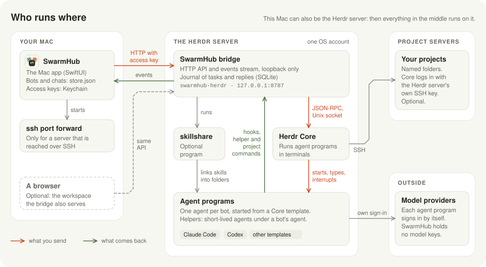
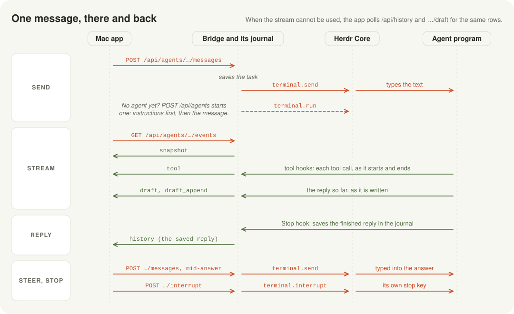
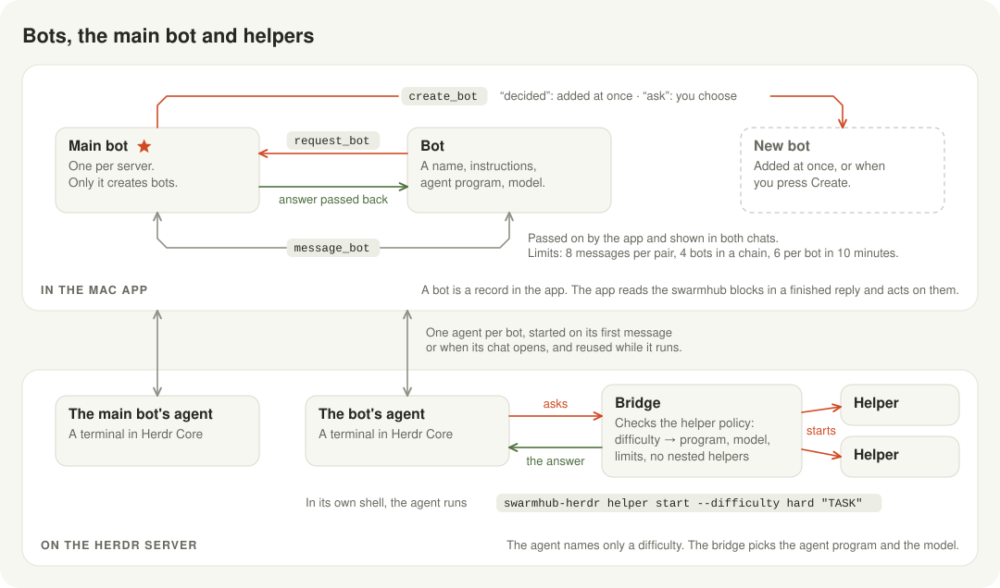

# SwarmHub architecture

How SwarmHub is put together, for someone new to the code. It takes about ten minutes to read. It was written from the code on the `herdr-workspace` branch; where something is planned or was not checked on a running system, it says so.

## In one paragraph

SwarmHub is a native Mac app for chatting with bots. A bot is a name, an avatar, instructions, an agent program and a model. The work is done by an agent: a real agent program, such as Claude Code or Codex, running in a terminal on a computer you choose. [Herdr Core](https://github.com/herdrdev/herdr-core), a separate project, runs those terminals. Beside it runs the SwarmHub bridge (`swarmhub-herdr`, in `HerdrWorkspace/`), which starts agents, types your messages into them, saves their replies, and serves an HTTP API. The Mac app talks only to the bridge. SwarmHub calls no model itself: each agent program signs in to its own provider.

## The pieces, and who runs where

<picture>
  <source media="(prefers-color-scheme: dark)" srcset="diagrams/overview-dark.svg">
  
</picture>

| Piece | What it does | Runs on | In this repository |
| --- | --- | --- | --- |
| **SwarmHub**, the Mac app | The chats, the bots, the setup window, Settings. Keeps bots and chats in `store.json` and access keys in the Keychain. | Your Mac | `Sources/AgentApp` (Swift, SwiftUI) |
| **SwarmHub bridge** | An HTTP API and an events stream on `127.0.0.1:8787`. Starts agents from Herdr Core's templates, types tasks into them, and keeps a journal of tasks and replies (SQLite). Also the commands agents and their hooks run. | The Herdr server | `HerdrWorkspace/` (Rust), binary `swarmhub-herdr` |
| **Herdr Core** | Runs agent programs in terminals and reaches other machines over SSH. The bridge speaks to its Unix socket (JSON-RPC: `terminal.run`, `terminal.send`, `terminal.interrupt`, `machine.exec` and others). | The Herdr server | Not here: [herdrdev/herdr-core](https://github.com/herdrdev/herdr-core) |
| **Agent programs** | Claude Code, Codex, or any other Herdr template. Each keeps its own conversation, tools, permissions and sign-in. | The Herdr server | Not here. The bridge wraps them: `run-claude`, `run-codex`, `run-opencode` |
| **skillshare** (optional) | A separate program that links one folder of skills into each agent program's skills folder. The bridge runs it. | The Herdr server | Not here |
| **Project servers** (optional) | Machines your projects live on. Herdr Core logs in to them with the Herdr server's own SSH key. | Anywhere SSH reaches | The bridge's part: `HerdrWorkspace/src/machines.rs`, `projects.rs` |
| **Browser workspace** | A browser interface to the same agents, served by the bridge. It has features the Mac app does not have. | Any browser that reaches the port | `HerdrWorkspace/web` |

"The Herdr server" is whichever computer runs Herdr Core and the bridge. It can be the Mac itself.

The Mac app does not install or start Herdr Core, the bridge, or the agent programs. You start them on that computer ([Run locally](../HerdrWorkspace/README.md#run-locally)).

## Where bots run

<picture>
  <source media="(prefers-color-scheme: dark)" srcset="diagrams/deployment-dark.svg">
  
</picture>

The setup window offers four choices. Three work:

1. **This Mac.** The app looks for the bridge on `127.0.0.1:8787` and reads the access key from `~/.config/swarmhub-herdr/token`, the file the bridge's start script writes.
2. **A server I reach over SSH.** The app runs the system `ssh` as a child process (`ssh -N -L 127.0.0.1:<port>:127.0.0.1:<port>`, batch mode), checks before every request that the forward is up and reopens it when it is not, and reads the access key from the server's token file over the same SSH login. It saves the path of a key file, never a key.
3. **A server by address and access key.** For a port you forwarded yourself. You paste the access key.
4. **Get a ready-made server from us.** A placeholder, shown as "Coming soon". Nothing is behind it (`Setup/ManagedHosting.swift`, `isAvailable = false`).

The bridge binds to loopback and refuses any request whose `Host` header is not `127.0.0.1:<port>` or `localhost:<port>`. That is why a remote server is always reached through a forward that keeps the same port number on both ends, and why two servers that use the same bridge port cannot be connected at once.

The app keeps a list of servers (`HerdrServer`, in `UserDefaults`); each bot is bound to one. Code: `Backends/HerdrServers.swift`, `Backends/HerdrSetup.swift`, `Setup/`.

## How a message travels

<picture>
  <source media="(prefers-color-scheme: dark)" srcset="diagrams/message-flow-dark.svg">
  
</picture>

**Send.** `HerdrBackend.send` takes only your newest message, because the agent keeps its own conversation. `HerdrClient.deliver` looks for the bot's running agent (by name; a bot's agent is named after the bot and ends in the start of the bot's id).

- If one runs, the message goes to `POST /api/agents/{address}/{created_ms}/messages`. The bridge saves it in its journal and has Herdr Core type it into the terminal (`terminal.send`).
- If none runs, `POST /api/agents` starts one from the bot's template and model (`terminal.run`). The first task is the bot's instructions, the app's notes (how to ask for a bot, start a helper, write to another bot), and then your message. A task is plain text of at most 16 KB.

**Stream.** The app opens `GET /api/agents/{address}/{created_ms}/events`, one Server-Sent Events connection per turn. The first event is a snapshot; after it the bridge sends only what changed.

- *Tool steps.* `run-claude` and `run-codex` give the agent program hooks for the start and end of every tool call. Each hook runs `swarmhub-herdr tool-activity`, which writes one line to the bridge's local socket (`replies.sock`). The app shows them as steps under the reply. These hooks only report: they cannot allow, deny or delay a tool.
- *The reply so far.* Codex: `run-codex` starts a private Codex app server for the session and a follower (`codex-stream`) that passes on the text being written. Claude Code: a template with `--workspace-preview` adds a hook that passes on finished lines. Without either, the reply appears whole at the end.

**Reply.** When the turn ends, the agent program's Stop hook runs `swarmhub-herdr capture-claude-reply` (or `capture-codex-reply`), which writes the reply straight into the journal. It finds the journal and its own session through two environment variables the bridge set at launch (`SWARMHUB_JOURNAL`, `SWARMHUB_LAUNCH_KEY`), so a reply is saved even while the bridge is stopped. The bridge notices the new row and sends it as a `history` event. That saved row is the final reply.

**Steer and stop.** A message sent while the agent answers is typed into the running agent, which reads it when it can. A bot can have steer turned off; then, and for a message with attachments, the app holds the message until the answer ends. Stop calls `POST …/interrupt`, and Herdr Core presses the agent program's own interrupt key. The agent stays open.

**When the stream cannot be used.** The bridge allows 48 open streams. If the stream cannot be opened or breaks three times in a row, the app polls `GET /api/history/…` and `…/draft` instead. Both read the same state, so nothing is shown twice (`Backends/HerdrTurnFollower.swift`).

**When no reply comes.** A reply exists only if the Stop hook saved one. An agent that stops at a prompt in its terminal (a trust question, a sign-in) saves none; the app stops waiting once the agent has been idle without a reply for 45 seconds (150 while its program is still starting) and says so. You answer the prompt in the browser workspace or with `hc attach`.

Code: `Backends/HerdrBackend.swift`, `HerdrClient.swift`, `HerdrEvents.swift` on the Mac; `main.rs`, `events.rs`, `live_reply.rs`, `tool_activity.rs`, `agent.rs`, `codex_agent.rs`, `history.rs` in the bridge.

## How agents are started and kept ready

- **One bot, one agent.** The agent is started on the bot's first message and reused while it runs. Later messages carry none of the instructions again.
- **Started ahead of the first message.** An agent program takes from seconds to a minute to start. When you open a bot's chat, the app starts its agent with no task (`POST /api/agents` with `"warm": true`) if none is running. Only the bot on screen is started, and never a second agent for a bot. A message sent while the program is still starting is kept by the bridge and typed once the program reports that it is ready; if it has not reported after 5 minutes, the message is marked as not sent. **Keep its agent ready** turns this off for one bot.
- **An agent nobody writes to.** The bridge ends an agent that was started this way and never given a task after 30 minutes (`SWARMHUB_WARM_IDLE_MINUTES`). An agent that has had a task is never ended this way.
- **Start a fresh agent** ends the running agent. The chat stays in the app; the agent's own memory of it does not.
- **Restarts.** Herdr Core keeps the terminals. Agents keep running when the Mac app quits, when the Mac sleeps, and when the bridge restarts.

Code: `Stores/AppStore+HerdrWarm.swift`, `HerdrWorkspace/src/warm.rs`.

## Bots, the main bot and helpers

<picture>
  <source media="(prefers-color-scheme: dark)" srcset="diagrams/bots-and-helpers-dark.svg">
  
</picture>

Two different mechanisms are at work here, and they live in different places.

**Between bots: the Mac app passes things on.** A bot is a record in the app; the bridge knows agents, not bots. An agent asks the app for something by ending its reply with a fenced block marked `swarmhub` that holds JSON. The app reads these blocks from the finished reply, hides them in the chat, and acts.

| Block | Who writes it | What the app does |
| --- | --- | --- |
| `create_bot` | The server's main bot (the one with the star; one per server) | With `"decision":"decided"` it adds the bot at once. Otherwise, or with **Ask me before creating bots** on, it shows the request above the composer with **Create** and **Dismiss**. |
| `request_bot` | Any other bot | Puts the request into the main bot's chat, marked as passed on, and the main bot's answer back into the asking bot's chat. |
| `decline_bot` | The main bot | Tells the asking bot why not. |
| `message_bot` | Any bot | Puts the message into the named bot's chat as its next message, and that bot's reply back into the sender's chat. Both chats show everything. |

A new bot is only a record. Nothing is created on the server until it gets its first message or its chat is opened.

Because the app does the passing on, it happens only while the app runs. With the app closed, no message moves between bots.

**Under a bot: the bridge starts helpers.** An agent hands a task to a helper by running `swarmhub-herdr helper start --difficulty easy|medium|hard "TASK"` in its own shell. The command only asks; the bridge decides. It takes the agent program and the model for that difficulty from the server's helper policy (`helper-policy.json`), starts the helper as one more terminal in Herdr Core, and stops it some time after its answer. The agent reads the answer with `helper wait`. The Mac app shows running helpers under the bot and opens one read-only; it never starts or stops one.

The command reaches the bridge over a local socket (`helpers.sock`). Codex runs shell commands in a sandbox that refuses connections, so there the command leaves a signed request file in a folder inside the agents' working folder and the bridge answers with a file beside it.

Code: `Backends/HerdrBotRequest.swift`, `HerdrBotRelay.swift`, `HerdrBotMessage.swift`, `Stores/AppStore+HerdrBots.swift`, `AppStore+HerdrMessages.swift`, `Backends/HerdrHelpers.swift`; `HerdrWorkspace/src/helpers.rs` and `helpers/`.

### Communication: the target and today

[How bots communicate](bot-communication.md) is the behaviour SwarmHub is being built towards. It is a specification, and most of it does not exist yet.

| | Today | In the specification, not built |
| --- | --- | --- |
| Messages between bots | One kind of message. Delivered as the receiver's next message, answer passed back, both chats show it, follow-ups allowed. | Three kinds (ask, tell, hand off), ownership of a piece of work, accept or decline of a hand-off. |
| Endings | An exchange ends when no bot writes on, when a limit is reached, or when you stop a bot. | "Not answered in time" with time limits (10 minutes for an ask, 5 to accept a hand-off). |
| Limits | 8 messages between the same two bots in one exchange, 4 bots in a chain, 6 messages per bot in 10 minutes. | The same numbers. |
| Switches | **Other bots can message it**, per bot. | **Takes initiative**. |
| Initiative | None. A bot writes only in reply to a message. | The main bot offering work and flagging problems, planned check-ins that run on the server, tracking of promises. |
| Measurement | Unit tests of the parsing, the limits and the passing on. | Thirteen scenarios run ten times each with real Claude Code and Codex agents, with a bar of 9 in 10. No results have been published. |

[Approvals](approvals.md) is a second specification of the same kind. Today the bridge can show Claude Code and Codex permission requests in the browser workspace when a template opts in. Levels, rules, reviewer bots, and anything in the Mac app are not built.

## Models, skills and projects

**Models.** The app names no agent program and no model. `GET /api/workspace` lists the server's templates; each can carry a list of models from the server's `runtime-catalog.json`, and a Codex or OpenCode template can ask the agent program for its own list. A bot with no model of its own starts on the first model the server lists. A change applies to the next agent the bot starts.

**Skills.** If [skillshare](https://skillshare.runkids.cc) is installed on the server, the bridge runs it (as a program with fixed arguments, never through a shell) to list skills, turn one on or off, and sync. The app shows the library in Settings and in a bot's Details; a switch changes the library and then runs a sync. Skills are shared per agent program for the whole server account, not per bot. Neither the app nor the bridge installs or removes skills.

**Projects.** A project server is a machine in Herdr Core (`hc machine add`). The bridge adds what the app needs: the Herdr server's public key to paste, a check of the host's fingerprint before it is trusted, named folders as projects, and for each agent the list of projects it may use. An agent works there with `swarmhub-herdr project run|read|write|edit NAME …`, which reaches the bridge the same way `helper` does; the bridge has Herdr Core run the command on the project server.

Code: `Backends/HerdrSkills.swift`, `HerdrProjects.swift`; `HerdrWorkspace/src/runtimes.rs`, `skillshare.rs`, `machines.rs`, `projects.rs`.

## The browser workspace

The bridge serves a browser interface at its own address (`HerdrWorkspace/web`, compiled into the binary). It was built first and does more than the Mac app in some areas: a Library of results, Pages, routines and webhooks, approval of permission requests, connected files, taking over an agent's terminal. It uses the same API and the same access key. The Mac app and the browser can be used side by side on the same agents. Its manual is [HerdrWorkspace/README.md](../HerdrWorkspace/README.md).

## Enforced in code, or asked of the model

An agent program is a model with a shell. Some rules are checked by code that the model cannot talk its way past; others are instructions the model is given. The difference matters.

| Rule | How it holds |
| --- | --- |
| A helper's agent program and model come from the server's policy | **Code** (bridge). The command has no option for either. |
| A helper cannot start helpers; at most `max_running` helpers per agent; a helper is stopped after its answer or when it goes too long without one | **Code** (bridge) |
| Limits on messages between bots (8, 4, 6 in 10 minutes); **Other bots can message it** | **Code** (Mac app). A message over a limit is not passed on. |
| Only the main bot creates bots; **Ask me before creating bots**; a bot it asks about waits for **Create** | **Code** (Mac app). A `create_bot` block from another bot is not acted on. |
| The `project` command works only for the projects an agent was given, and only inside a project's folder for `read`, `write`, `edit` | **Code** (bridge), for that command only. See below: it is not a wall. |
| Tool-step and reply hooks cannot change what a tool does | **Code** (bridge). They only report. |
| A bot uses helpers when a task is worth it, picks an honest difficulty, writes to another bot only when its job is needed, asks instead of acting | **Asked of the model.** The app tells the agent how in its first task. |
| **Can start helper agents** off | **Asked of the model.** The agent is simply not told about the command. |
| A bot keeps to its instructions and to its own work | **Asked of the model.** |
| What an agent may run, read and change on the server | **The agent program's own permission settings**, not SwarmHub. |

## Trust and security

Stated plainly, so nobody assumes more than there is.

- **The bridge listens on loopback only** and checks the `Host` header, and for a `POST` the `Origin` header. It cannot be given a public address. It speaks plain HTTP; from another machine it is reached through an SSH forward, and SSH is what protects the traffic.
- **The access key** is a random 64-character hex string in the bridge's environment and, with the start script, in `~/.config/swarmhub-herdr/token` (readable by the account only). Every `/api/` request carries it as a bearer token. Anyone who has it and can reach the port can do everything the bridge can: start agents, type into them, read every conversation. On the Mac it is kept in the Keychain.
- **SSH from the Mac to the Herdr server** uses the system `ssh` with your keys, agent and known hosts. A server seen for the first time is trusted and remembered without a question (`StrictHostKeyChecking=accept-new`); a server whose key later changes is refused.
- **One OS account for all agents.** Every agent, every helper, the bridge and Herdr Core run as the same user on the Herdr server. There is no isolation between bots: an agent with a shell can read another agent's files, the journal and the access key file.
- **The per-bot lists are bookkeeping, not walls.** The projects a bot may use decide what the `project` command does for its agent. The account can still log in to every project server, and an agent whose shell is not sandboxed can run `ssh` or `hc` itself. The same holds for "Can start helper agents" and for which skills an agent program loads. To keep an agent away from something for real, use the agent program's own permission and sandbox settings, or do not give that Herdr server access to it.
- **Project servers** are reached with the Herdr server's own SSH key, key-based only. The bridge does not trust a new host silently: the app shows the fingerprints and nothing is saved until you press **Trust this server**. Adding a server copies Herdr Core's helper program to it.
- **The journal is plaintext.** Tasks, replies, captured terminal text and published files are in a SQLite file under `~/.local/state/swarmhub-herdr/` on the Herdr server. The Mac keeps its own copy of the chats in `store.json`, also plaintext.
- **Model providers** see what the agent programs send them. SwarmHub holds no provider keys and makes no model calls.
- **Dictation**, if you use it, sends the recording to deAPI with your own key.

## Data, and data from older versions

| Where | What |
| --- | --- |
| Mac: `~/Library/Application Support/AgentApp/store.json` | Bots, groups, chats |
| Mac: `runtime.sqlite`, `attachments/`, `artifacts/` beside it | Saved documents, the queue of messages waiting to be sent, attached images |
| Mac: `UserDefaults` | The server list; each bot's server, template, model and switches |
| Mac: Keychain | Access keys, the deAPI key |
| Server: `~/.local/state/swarmhub-herdr/workspace.sqlite3` | The bridge's journal |
| Server: `helper-policy.json`, `runtime-catalog.json` beside it | Helper policy, model catalog |
| Server: `~/.config/swarmhub-herdr/token` | The access key |

Older versions of the app ran bots on two other backends, which were removed. When the app opens a store that still holds such bots, it first copies the file unchanged to `store.json.before-herdr-only-<time>`, then saves the store without them and says once how many bots were left out and where the copy is. Nothing is migrated (`Models/LegacyStore.swift`). A `store.json` that cannot be read is moved aside, never deleted.

## Where each part lives

| Path | Contents |
| --- | --- |
| `Sources/AgentApp/Backends` | `AgentBackend` (the protocol), `HerdrBackend`, `HerdrClient` and the other `Herdr*` files: everything that talks to the bridge. `MockBackend` answers the sample agents. |
| `Sources/AgentApp/Stores` | `AppStore` and its extensions: bots, turns, steer, the message queue, relaying between bots, helpers, starting agents ahead of time, saving. |
| `Sources/AgentApp/Setup` | The setup window, its state machine (`SetupFlow`) and its words. |
| `Sources/AgentApp/Views`, `Models`, `Avatars`, `Voice` | SwiftUI views, data types, avatars, dictation and read aloud. |
| `Sources/AgentApp/GrokExport`, `GrokImport`, `TemplateImport` | Import from Grok Bot and from template files; the headless commands, including the screen renders. |
| `Tests/AgentAppTests` | The Mac tests (`swift test` on a Mac). |
| `HerdrWorkspace/src` | The bridge. `main.rs` (routes, the access check), `core.rs` (Herdr Core's protocol), `history.rs` (journal), `events.rs`, `live_reply.rs`, `tool_activity.rs`, `warm.rs`, `helpers.rs`, `machines.rs`, `projects.rs`, `skillshare.rs`, `agent.rs` and `codex_agent.rs` (the wrappers and hooks). The other modules serve the browser workspace. |
| `HerdrWorkspace/web`, `tests`, `dev` | The browser workspace, its checks, and `start-local.sh`. |
| `Resources/` | Info.plist, entitlements, the app icon, avatars. |
| `scripts/` | Build, run, packaging and update scripts; the Grok Bot export tools; the icon's drawing script. |
| `docs/diagrams` | These drawings and the script that writes them (`generate.py`). |
| `Apps/iOS-seed` | Starting material for a possible iPhone app. Not an app; nothing builds it. |

## Not built, or not checked

- A ready-made server, billing and provisioning: not built.
- Most of [How bots communicate](bot-communication.md) and of [Approvals](approvals.md): see the tables above.
- An iPhone app: none. A phone cannot reach the bridge, which answers only on its own machine.
- The Mac app does not install Herdr Core, the bridge or agent programs.
- This document was checked against the source. It was not checked by running every path on a live system; the measured numbers it repeats (start times, limits in seconds) come from the code and from [the bridge's manual](../HerdrWorkspace/README.md).
