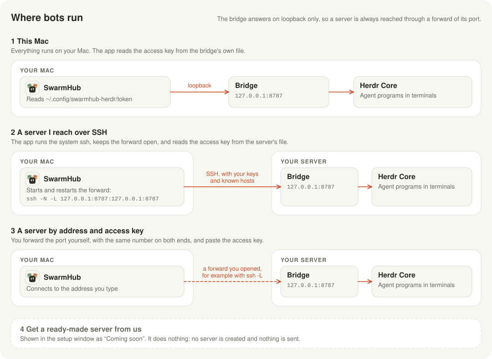

# SwarmHub architecture

How SwarmHub is put together, for someone new to the code. It takes about ten minutes to read. It was written from the code on the `herdr-workspace` branch; where something is planned or was not checked on a running system, it says so.

## In one paragraph

SwarmHub is a native Mac app for chatting with bots. A bot is a name, an avatar, instructions, an agent program and a model. The work is done by an agent: a real agent program, such as Claude Code or Codex, running in a terminal on a computer you choose. [Herdr Core](https://github.com/herdrdev/herdr-core), a separate project, runs those terminals. Beside it runs the SwarmHub bridge (`swarmhub-herdr`, in `HerdrWorkspace/`), which starts agents, types your messages into them, saves their replies, and serves an HTTP API. The Mac app talks only to the bridge. SwarmHub calls no model itself: each agent program signs in to its own provider.

The interface uses plainer words than this document. In the app an agent program is a bot's **AI** and reads "Claude" or "Codex", a helper agent is a **helper**, ending a bot's agent is **Start fresh**, and the bridge is "the SwarmHub service" in the setup window and "the workspace" in Software Update. The app never says template or runtime. This document keeps the technical names (agent, agent program, template, bridge), because they are what the mechanism is made of.

## The pieces, and who runs where

<picture>
  <source media="(prefers-color-scheme: dark)" srcset="diagrams/overview-dark.svg">
  
</picture>

| Piece | What it does | Runs on | In this repository |
| --- | --- | --- | --- |
| **SwarmHub**, the Mac app | The chats, the bots, the setup window, Settings with Software Update. Keeps bots and chats in `store.json` and access keys in the Keychain. | Your Mac | `Sources/AgentApp` (Swift, SwiftUI) |
| **SwarmHub bridge** | An HTTP API and an events stream on `127.0.0.1:8787`. Starts agents from Herdr Core's templates, types tasks into them, and keeps a journal of tasks and replies (SQLite). Also the commands agents and their hooks run. Reports its version and can replace itself with a newer signed release. | The Herdr server | `HerdrWorkspace/` (Rust), binary `swarmhub-herdr` |
| **Herdr Core** | Runs agent programs in terminals and reaches other machines over SSH. The bridge speaks to its Unix socket (JSON-RPC: `terminal.run`, `terminal.send`, `terminal.interrupt`, `machine.exec` and others). | The Herdr server | Not here: [herdrdev/herdr-core](https://github.com/herdrdev/herdr-core) |
| **Agent programs** | Claude Code, Codex, or any other Herdr template. Each keeps its own conversation, tools, permissions and sign-in. | The Herdr server | Not here. The bridge wraps them: `run-claude`, `run-codex`, `run-opencode` |
| **skillshare** (optional) | A separate program that keeps one library of skills, agents, MCP servers, plugins and hooks and syncs it into each agent program's own folders and settings. The bridge runs it. | The Herdr server | Not here |
| **Project servers** (optional) | Machines your projects live on. Herdr Core logs in to them with the Herdr server's own SSH key. | Anywhere SSH reaches | The bridge's part: `HerdrWorkspace/src/machines.rs`, `projects.rs` |
| **Browser workspace** | A browser interface to the same agents, served by the bridge. It has features the Mac app does not have. | Any browser that reaches the port | `HerdrWorkspace/web` |

"The Herdr server" is whichever computer runs Herdr Core and the bridge. It can be the Mac itself.

On this Mac the app can set all of it up: it fetches the bridge from the signed release, checks it, and runs the bridge's own `service install`, which installs Herdr Core when it is missing and has launchd keep the bridge running ([Run on macOS](../HerdrWorkspace/README.md#run-on-macos)). On a server you install and start Herdr Core and the bridge yourself ([Run locally](../HerdrWorkspace/README.md#run-locally)). The app never installs an agent program. Once a bridge runs, the app can update it and start Herdr Core's own updater ([Updates](#updates)).

## Where bots run

<picture>
  <source media="(prefers-color-scheme: dark)" srcset="diagrams/deployment-dark.svg">
  
</picture>

The app reaches a Herdr server in three ways. The setup window shows the first two as large options and folds the third under **Advanced**. A fourth is only announced. (The drawing labels the second and third by how they work.)

1. **This Mac.** The app looks for the bridge on `127.0.0.1:8787` and reads the access key from `~/.config/swarmhub-herdr/token`, the file the bridge writes. When nothing answers, the setup window offers to set the Mac up (`Backends/HerdrLocalService.swift`, `Stores/AppStore+LocalSetup.swift`): the program for this Mac's processor is downloaded and checked against the release key exactly as an update handed to a server is (`WorkspaceRelease`), put in `~/.local/bin`, and run as `service install`. Everything else about the setup is the bridge's own code (`HerdrWorkspace/src/service.rs`, `first_time.rs`), so it is the same from a terminal.
2. **A server**, reached over SSH. The app runs the system `ssh` as a child process (`ssh -N -L 127.0.0.1:<port>:127.0.0.1:<port>`, batch mode), checks before every request that the forward is up and reopens it when it is not, and reads the access key from the server's token file over the same SSH login. It saves the path of a key file, never a key.
3. **A server by address.** For a port you forwarded yourself. You type the address and paste the access key.
4. **Get a ready-made server from us.** One line marked "Coming soon", which cannot be chosen. It is planned; nothing is behind it (`Setup/ManagedHosting.swift`, `isAvailable = false`).

The bridge binds to loopback and refuses any request whose `Host` header is not `127.0.0.1:<port>` or `localhost:<port>`. That is why a remote server is always reached through a forward that keeps the same port number on both ends, and why two servers that use the same bridge port cannot be connected at once.

The app keeps a list of servers (`HerdrServer`, in `UserDefaults`); each bot is bound to one. Code: `Backends/HerdrServers.swift`, `Backends/HerdrSetup.swift`, `Setup/`.

## How a message travels

<picture>
  <source media="(prefers-color-scheme: dark)" srcset="diagrams/message-flow-dark.svg">
  
</picture>

**Send.** `HerdrBackend.send` takes only your newest message, because the agent keeps its own conversation. `HerdrClient.deliver` looks for the bot's running agent (by name; a bot's agent is named after the bot and ends in the start of the bot's id).

- If one runs, the message goes to `POST /api/agents/{address}/{created_ms}/messages`. The bridge saves it in its journal and has Herdr Core type it into the terminal (`terminal.send`).
- If none runs, `POST /api/agents` starts one from the bot's template and model (`terminal.run`). The first task is the bot's instructions, "About you" when it has text, the app's notes (how to ask for a bot, start a helper, write to another bot), and then your message. A task is plain text of at most 16 KB.

**Stream.** The app opens `GET /api/agents/{address}/{created_ms}/events`, one Server-Sent Events connection per turn. The first event is a snapshot; after it the bridge sends only what changed.

- *Tool steps.* `run-claude` and `run-codex` give the agent program hooks for the start and end of every tool call. Each hook runs `swarmhub-herdr tool-activity`, which writes one line to the bridge's local socket (`replies.sock`). The app shows them as steps under the reply. These hooks only report: they cannot allow, deny or delay a tool.
- *The reply so far.* Codex: `run-codex` starts a private Codex app server for the session and a follower (`codex-stream`) that passes on the text being written. Claude Code: a template with `--workspace-preview` adds a hook that passes on finished lines. Without either, the reply appears whole at the end.

**Reply.** When the turn ends, the agent program's Stop hook runs `swarmhub-herdr capture-claude-reply` (or `capture-codex-reply`), which writes the reply straight into the journal. It finds the journal and its own session through two environment variables the bridge set at launch (`SWARMHUB_JOURNAL`, `SWARMHUB_LAUNCH_KEY`), so a reply is saved even while the bridge is stopped. The bridge notices the new row and sends it as a `history` event. That saved row is the final reply.

**Steer and stop.** A message sent while the agent answers is typed into the running agent, which reads it when it can. A bot can have steer turned off; then, and for a message with attachments, the app holds the message until the answer ends. Stop calls `POST …/interrupt`, and Herdr Core presses the agent program's own interrupt key. The agent stays open.

**When the stream cannot be used.** The bridge allows 48 open streams. If the stream cannot be opened or breaks three times in a row, the app polls `GET /api/history/…` and `…/draft` instead. Both read the same state, so nothing is shown twice (`Backends/HerdrTurnFollower.swift`).

**When no reply comes.** A reply exists only if the Stop hook saved one. An agent that stops at a prompt in its terminal (a trust question, a sign-in) saves none; the app stops waiting once the agent has been idle without a reply for 45 seconds (150 while its program is still starting) and says so. Mac chat opens the attached terminal in a sheet. The bridge verifies its session address and creation time before accepting input.

Code: `Backends/HerdrBackend.swift`, `HerdrClient.swift`, `HerdrEvents.swift` on the Mac; `main.rs`, `events.rs`, `live_reply.rs`, `tool_activity.rs`, `agent.rs`, `codex_agent.rs`, `history.rs` in the bridge.

## How agents are started and kept ready

- **One bot, one agent.** The agent is started on the bot's first message and reused while it runs. Later messages carry none of the instructions again.
- **Started ahead of the first message.** An agent program takes from seconds to a minute to start. When you open a bot's chat, the app starts its agent with no task (`POST /api/agents` with `"warm": true`) if none is running. Only the bot on screen is started, and never a second agent for a bot. A message sent while the program is still starting is kept by the bridge and typed once the program reports that it is ready; if it has not reported after 5 minutes, the message is marked as not sent. The switch **Keep _name_ ready** (a bot's Details, **Model**, **Advanced**) turns this off for one bot.
- **An agent nobody writes to.** The bridge ends an agent that was started this way and never given a task after 30 minutes (`SWARMHUB_WARM_IDLE_MINUTES`). An agent that has had a task is never ended this way.
- **A fresh agent.** **Start fresh** in the Model tab ends the running agent. The chat stays in the app; the agent's own memory of it does not.
- **Restarts.** Herdr Core keeps the terminals. Agents keep running when the Mac app quits, when the Mac sleeps, and when the bridge restarts.

Code: `Stores/AppStore+HerdrWarm.swift`, `HerdrWorkspace/src/warm.rs`.

## Bots, the main bot and helpers

<picture>
  <source media="(prefers-color-scheme: dark)" srcset="diagrams/bots-and-helpers-dark.svg">
  
</picture>

**Between bots.** The Mac app registers each bot’s stable ID, agent program, model, instructions and switches with its bridge. The bridge delivers asks, tells and handoffs, enforces limits and saves the exchange in both bots’ histories. Bots can work with the Mac closed. When the app reconnects, it fetches history after its saved cursor. A journal ID links a live reply to its saved copy.

The main bot can propose or create a new bot with a `create_bot` block. The Mac app handles the creation decision and the **Ask me before creating bots** setting. **Remember** saves a proposed `about_you` addition. An older bridge without the bot directory uses the app’s original relay while the app is running.

**Under a bot: the bridge starts helpers.** An agent hands a task to a helper by running `swarmhub-herdr helper start --difficulty easy|medium|hard "TASK"` in its own shell. The command only asks; the bridge decides. It takes the agent program and the model for that difficulty from the server's helper policy (`helper-policy.json`), starts the helper as one more terminal in Herdr Core, and stops it some time after its answer. The agent reads the answer with `helper wait`. The Mac app shows running helpers under the bot and opens one read-only; it never starts or stops one.

The command reaches the bridge over a local socket (`helpers.sock`). Codex runs shell commands in a sandbox that refuses connections, so there the command leaves a signed request file in a folder inside the agents' working folder and the bridge answers with a file beside it.

**The first conversation and "About you".** "About you" is a text of at most 800 characters in the app's settings (`UserDefaults`), which you edit under **Settings → General**. The app gives it to every bot's agent with its instructions, and again when it has changed. When you ask the main bot for an introduction, the app sends that bot one note in your place: greet the person, say what you can do, ask five short questions one at a time, and do no other work until asked. The chat shows the note as a single line. The main bot proposes what to remember with `about_you` blocks, and nothing is saved until you press **Remember**. A main bot that never had this conversation offers it once; **Get to know me** in its composer's **+** menu asks for it again. That the bot keeps to the questions and does no other work is asked of the model, not enforced.

Code: `Backends/HerdrBotRequest.swift`, `HerdrBotRelay.swift`, `HerdrBotMessage.swift`, `HerdrPassedOn.swift`, `HerdrAboutYou.swift`, `Stores/AppStore+HerdrBots.swift`, `AppStore+HerdrMessages.swift`, `AppStore+HerdrIntro.swift`, `Backends/HerdrHelpers.swift`; `HerdrWorkspace/src/helpers.rs` and `helpers/`.

### Communication: the target and today

The bridge owns message delivery, handoff deadlines, check-ins and promises. The main bot receives rate-limited notices and can offer to help. A requested check-in can wake its assigned bot directly. A public PR watch checks the head commit on the bridge and wakes the bot on a failed check. The Mac app surfaces open work in **Details → Team activity**. [Communication rules](bot-communication.md) · [Agent scenario results](bot-communication-results.md)

[Approvals](approvals.md) is a second specification of the same kind. Mac chat can approve or deny a request from the current agent session when its template enables the approval hook. The browser workspace also provides the workspace-wide inbox, history, and temporary read rules.

## Models, skills and projects

**Models.** The app keeps no list of agent programs or models. `GET /api/workspace` lists the server's templates; each can carry a list of models from the server's `runtime-catalog.json`, and a Codex or OpenCode template can ask the agent program for its own list. The app shows a template by its agent program's short name: the display name the server sends, else the program's name without a last word that only says what kind of program it is ("Claude Code" reads "Claude"). The template's own name is added only where two choices would read the same. A bot with no model of its own starts on the first model the server lists. A change applies to the next agent the bot starts.

**Skills.** If [skillshare](https://skillshare.runkids.cc) is installed on the server, the bridge runs it (as a program with fixed arguments, never through a shell) and keeps no copy of what it says. A server at API level 2 serves the whole library: skills, agents, MCP servers, plugins and hooks, with what a sync would change, previews, installing from a repository after an audit, updating, removing, and the library's Git repository. The app shows a summary under **Settings → Servers → Skills** and in the Skills tab of a bot's Details, and the library itself in a sheet (Overview, Library, Servers). A change in the library is followed by a sync. On a level-1 server the app shows the list of switches it had. What could hold a secret stays on the server: the bridge sends the names of an MCP server's environment values, headers and token, never the values. The library is shared per agent program for the whole server account, not per bot; a project folder with a skillshare project of its own has its own.

**Projects.** A project server is a machine in Herdr Core (`hc machine add`). The bridge adds what the app needs: the Herdr server's public key to paste, a check of the host's fingerprint before it is trusted, named folders as projects, and for each agent the list of projects it may use. An agent works there with `swarmhub-herdr project run|read|write|edit NAME …`, which reaches the bridge the same way `helper` does; the bridge has Herdr Core run the command on the project server.

Code: `Backends/HerdrSkills.swift`, `HerdrSkillLibrary*.swift`, `Stores/HerdrSkillLibraryModel.swift`, `HerdrProjects.swift`; `HerdrWorkspace/src/runtimes.rs`, `skillshare.rs` and `skillshare/` (`library.rs`, `install.rs`, `source.rs`), `machines.rs`, `projects.rs`.

## Updates

Three things are updated, each by its own mechanism, and **Settings → Software Update** shows them together with one button when something is behind. The full description, with what is trusted and the release steps, is in [Updates](updates.md).

- **The Mac app** updates through Sparkle (`Stores/AppUpdater.swift`). Scheduled checks run once a day without a window; what they find shows as a line in the sidebar and in Software Update. Sparkle checks every archive against the EdDSA key in `Info.plist` before it unpacks it. A bare executable, as `scripts/run.sh` starts it, does not update itself.
- **The bridge** on each server, which the page calls the workspace. `GET /api/workspace` carries its version and an API level, and the app sends its own version and level with every request (`X-SwarmHub-App`, `X-SwarmHub-Api`), so neither side guesses what the other can do. To update, the app asks the server (`POST /api/update/check`, `/apply`); the server downloads the signed release, checks it, tries the new program against a copy of the journal, backs the journal up, and becomes the new program. Agents run in Herdr Core and keep running. A new version that does not start is replaced by the previous one. A server that cannot reach the releases is handed the release by the app (`/api/update/upload`) and checks it the same way.
- **Herdr Core**, and its helper program on project servers, are updated by Herdr's own commands (`hc update`, `hc machine update`). The bridge runs them when the app asks and passes on what they said.

Code: `Views/SoftwareUpdatePane.swift`, `Stores/SoftwareUpdateModel.swift`, `Backends/HerdrUpdates.swift`, `WorkspaceRelease.swift`; `HerdrWorkspace/src/update.rs`.

## The browser workspace

The bridge serves a browser interface at its own address (`HerdrWorkspace/web`, compiled into the binary). It was built first and does more than the Mac app in some areas: workspace-wide Library browsing, Page editing, routines and webhooks, approval history, and connected files. It uses the same API and the same access key. The Mac app and the browser can be used side by side on the same agents. Its manual is [HerdrWorkspace/README.md](../HerdrWorkspace/README.md).

## Enforced in code, or asked of the model

An agent program is a model with a shell. Some rules are checked by code that the model cannot talk its way past; others are instructions the model is given. The difference matters.

| Rule | How it holds |
| --- | --- |
| A helper's agent program and model come from the server's policy | **Code** (bridge). The command has no option for either. |
| A helper cannot start helpers; at most `max_running` helpers per agent; a helper is stopped after its answer or when it goes too long without one | **Code** (bridge) |
| Limits on messages between bots (8, 4, 6 in 10 minutes); **Other bots can message it** | **Code** (Mac app). A message over a limit is not passed on. |
| Only the main bot creates bots; **Ask me before creating bots**; a bot it asks about waits for **Create** | **Code** (Mac app). A `create_bot` block from another bot is not acted on. |
| Nothing joins "About you" without **Remember**; only the main bot's proposals are offered | **Code** (Mac app) |
| A server installs only a signed release that is newer than itself | **Code** (bridge). See [Updates](#updates). |
| The `project` command works only for the projects an agent was given, and only inside a project's folder for `read`, `write`, `edit` | **Code** (bridge), for that command only. See below: it is not a wall. |
| Tool-step and reply hooks cannot change what a tool does | **Code** (bridge). They only report. |
| A bot uses helpers when a task is worth it, picks an honest difficulty, writes to another bot only when its job is needed, asks instead of acting | **Asked of the model.** The app tells the agent how in its first task. |
| **Can use helpers** off | **Asked of the model.** The agent is simply not told about the command. |
| A bot keeps to its instructions and to its own work; the main bot's first conversation keeps to its questions | **Asked of the model.** |
| What an agent may run, read and change on the server | **The agent program's own permission settings**, not SwarmHub. |

## Trust and security

Stated plainly, so nobody assumes more than there is.

- **The bridge listens on loopback only** and checks the `Host` header, and for a `POST` the `Origin` header. It cannot be given a public address. It speaks plain HTTP; from another machine it is reached through an SSH forward, and SSH is what protects the traffic.
- **The access key** is a random 64-character hex string in the bridge's environment and, with the start script, in `~/.config/swarmhub-herdr/token` (readable by the account only). Every `/api/` request carries it as a bearer token. Anyone who has it and can reach the port can do everything the bridge can: start agents, type into them, read every conversation. On the Mac it is kept in the Keychain.
- **SSH from the Mac to the Herdr server** uses the system `ssh` with your keys, agent and known hosts. A server seen for the first time is trusted and remembered without a question (`StrictHostKeyChecking=accept-new`); a server whose key later changes is refused.
- **One OS account for all agents.** Every agent, every helper, the bridge and Herdr Core run as the same user on the Herdr server. There is no isolation between bots: an agent with a shell can read another agent's files, the journal and the access key file.
- **The per-bot lists are bookkeeping, not walls.** The projects a bot may use decide what the `project` command does for its agent. The account can still log in to every project server, and an agent whose shell is not sandboxed can run `ssh` or `hc` itself. The same holds for "Can use helpers" and for which skills an agent program loads. To keep an agent away from something for real, use the agent program's own permission and sandbox settings, or do not give that Herdr server access to it.
- **Project servers** are reached with the Herdr server's own SSH key, key-based only. The bridge does not trust a new host silently: the app shows the fingerprints and nothing is saved until you press **Trust this server**. Adding a server copies Herdr Core's helper program to it.
- **The journal is plaintext.** Tasks, replies, captured terminal text and published files are in a SQLite file under `~/.local/state/swarmhub-herdr/` on the Herdr server. The Mac keeps its own copy of the chats in `store.json`, also plaintext.
- **What SwarmHub tells agent programs to trust.** With the person's yes in the setup window, the bridge on this Mac tells Claude Code to trust the bots' folder (one entry in `~/.claude.json`, removed again with the service) and tells Codex at each start to trust the three hooks it passes (nothing written). A trusted folder is one whose own settings files the agent program uses, and an agent can write files there. No tool is allowed and no permission or sandbox setting is changed by this.
- **Model providers** see what the agent programs send them. SwarmHub holds no provider keys and makes no model calls.
- **"About you"** is plaintext in the app's settings on the Mac and is sent to every bot's agent, so it ends up in the journal and at the model providers like any other task text.
- **Updates** are signed. The app's archives and the bridge's releases are signed with one Ed25519 release key; Sparkle checks the first, the bridge checks the second itself, and the access key alone cannot make a server run anything that is not a signed, newer release. [Updates](updates.md#what-is-trusted) says what this does and does not cover.

## Data, and data from older versions

| Where | What |
| --- | --- |
| Mac: `~/Library/Application Support/AgentApp/store.json` | Bots, groups, chats |
| Mac: `runtime.sqlite`, `attachments/`, `artifacts/` beside it | Saved documents, the queue of messages waiting to be sent, attached images |
| Mac: `UserDefaults` | The server list; each bot's server, template, model and switches; "About you" |
| Mac: Keychain | Access keys |
| Server: `~/.local/state/swarmhub-herdr/workspace.sqlite3` | The bridge's journal |
| Server: `helper-policy.json`, `runtime-catalog.json` beside it | Helper policy, model catalog |
| Server: `~/.config/swarmhub-herdr/token` | The access key |
| Server: `backups/`, `update.json` in the bridge's data folder; `swarmhub-herdr.previous` beside the binary | The journal backups an update makes (the newest three), the record of the last update, and the program it replaced |

If SwarmHub cannot open `store.json`, it moves the complete file aside as `store.json.corrupt-<time>` and offers the newest readable backup, if one is available.

## Where each part lives

| Path | Contents |
| --- | --- |
| `Sources/AgentApp/Backends` | `AgentBackend` (the protocol), `HerdrBackend`, `HerdrClient` and the other `Herdr*` files: everything that talks to the bridge. `MockBackend` answers the sample bots. |
| `Sources/AgentApp/Stores` | `AppStore` and its extensions: bots, turns, steer, the message queue, relaying between bots, the first conversation, helpers, starting agents ahead of time, saving. `AppUpdater` and `SoftwareUpdateModel` for updates. |
| `Sources/AgentApp/Setup` | The setup window, its state machine (`SetupFlow`) and its words. |
| `Sources/AgentApp/Views`, `Models`, `Avatars` | SwiftUI views, data types, avatars. |
| `Sources/AgentApp/GrokExport`, `GrokImport`, `TemplateImport` | Import from Grok Bot and from template files; the headless commands, including the screen renders. |
| `Tests/AgentAppTests` | The Mac tests (`swift test` on a Mac). |
| `HerdrWorkspace/src` | The bridge. `main.rs` (routes, the access check), `core.rs` (Herdr Core's protocol), `history.rs` (journal), `events.rs`, `live_reply.rs`, `tool_activity.rs`, `warm.rs`, `helpers.rs`, `machines.rs`, `projects.rs`, `skillshare.rs`, `update.rs` (versions and self-update), `agent.rs` and `codex_agent.rs` (the wrappers and hooks). The other modules serve the browser workspace. |
| `HerdrWorkspace/web`, `tests`, `dev` | The browser workspace, its checks, and `start-local.sh`. |
| `Resources/` | Info.plist, entitlements, the app icon, avatars. |
| `scripts/` | Build, run, packaging and release scripts for the app and the bridge; the Grok Bot export tools; the icon's drawing script. |
| `docs/diagrams` | These drawings and the script that writes them (`generate.py`). |
| `Apps/iOS-seed` | Starting material for a possible iPhone app. Not an app; nothing builds it. |

## Not built, or not checked

- A ready-made server: planned, not built. There is no billing and no provisioning.
- Most of [How bots communicate](bot-communication.md) and of [Approvals](approvals.md): see the tables above.
- An iPhone app: none. A phone cannot reach the bridge, which answers only on its own machine.
- The Mac app sets up this Mac only. On a server, Herdr Core and the first bridge are installed by hand ([Updates](updates.md#first-install-on-a-server)). It installs no agent program anywhere.
- This document was checked against the source. It was not checked by running every path on a live system; the measured numbers it repeats (start times, limits in seconds) come from the code and from [the bridge's manual](../HerdrWorkspace/README.md).
