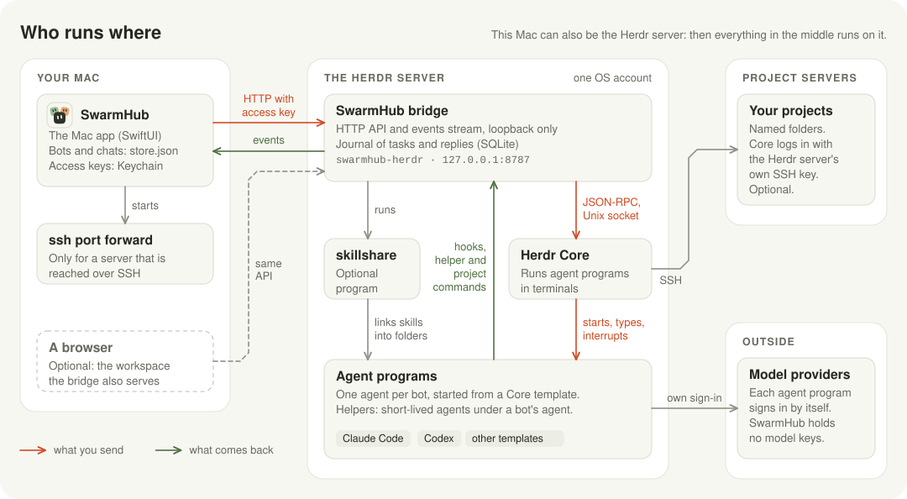
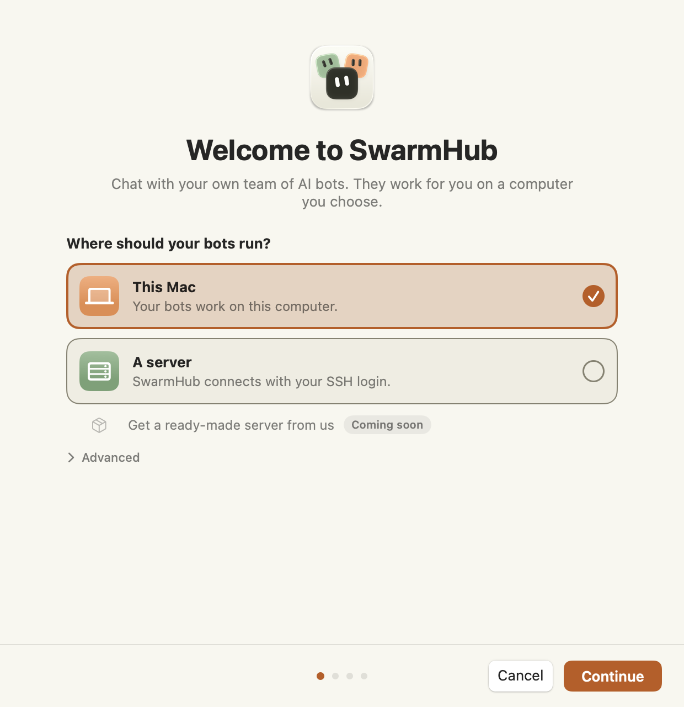
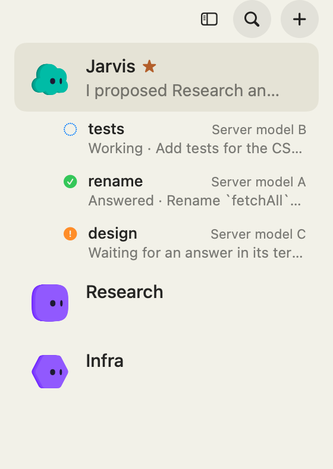
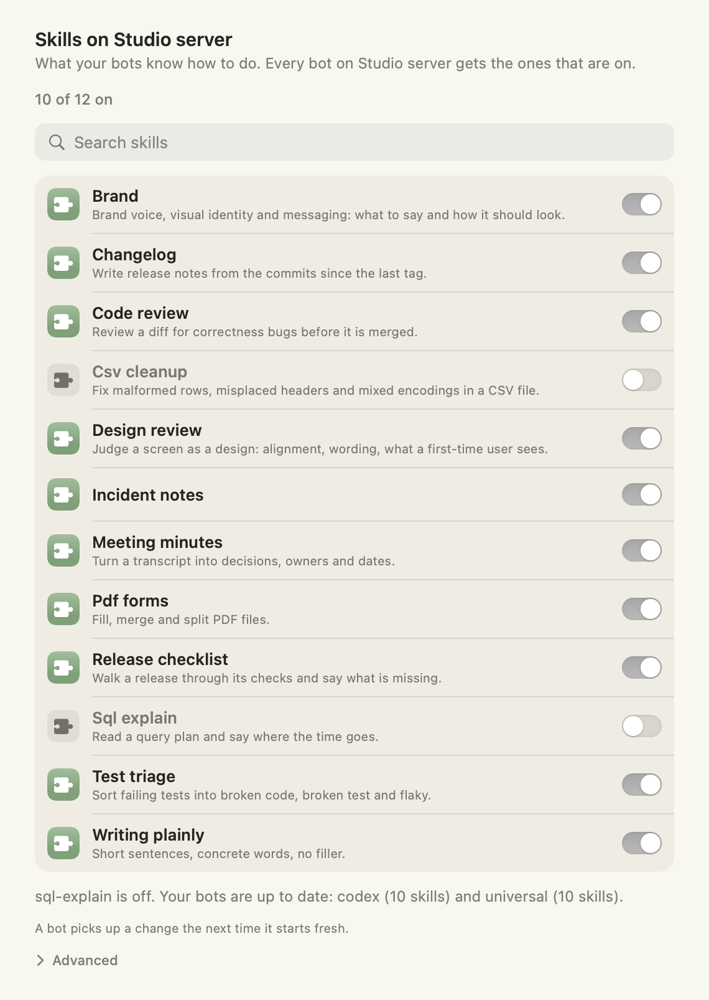

# SwarmHub guide

How to set up the Mac app and use it. The app chats with agents that Herdr Core runs. It reaches them through the SwarmHub bridge, a service that runs beside Herdr Core on the same machine.

<a id="how-it-works"></a>

## How it works

<picture>
  <source media="(prefers-color-scheme: dark)" srcset="diagrams/overview-dark.svg">
  
</picture>

A bot in the app is one agent on a Herdr server: an agent program such as Claude Code or Codex, running in a terminal there. Your message goes from the app to the bridge, Herdr Core types it into the agent, and the reply comes back as it is written. [Architecture](architecture.md) has the details.

## Get started

### 1. Run Herdr Core and the bridge

Bots work on the computer that runs Herdr Core: this Mac or a server. The Mac app does not install or start Herdr Core or the bridge. Follow [Run locally](../HerdrWorkspace/README.md#run-locally) on that computer. `HerdrWorkspace/dev/start-local.sh` starts an installed bridge and keeps its access key in `~/.config/swarmhub-herdr/token`, which is where the app looks for it.

Herdr Core needs at least one agent template, for example for Claude Code or Codex. Open each agent program once in the folder the agents start in, because a program that asks whether to trust a new folder gets no task.

### 2. Start the app

Build and run from a checkout on a Mac with Xcode:

```sh
./scripts/run.sh
```

The packaged build on the [releases page](https://github.com/conrader/swarmhub/releases) (0.6.8) is the earlier version of the app, from before it moved to Herdr Core, and does not match this guide. Use it only once a newer release is published.

### 3. Connect

The setup window opens while there is no bot. Later, use **Settings → Set up…**.

<picture>
  <source media="(prefers-color-scheme: dark)" srcset="screenshots/dark/setup-where.png">
  
</picture>

The screens in this guide are rendered by the app with sample content.

1. **Where.** Choose this Mac, a server you reach over SSH, or a server by address and access key.
2. **Connect.** Fill in what the choice needs and press **Test**. For this Mac, leave the access key empty. For SSH, give the server's name and, if needed, a login name and the path of a key file; a key with a passphrase must already be in the agent (`ssh-add`). When the test fails, the window says what is wrong.
3. **Main bot.** Create the server's main bot: a name, instructions, an avatar, an agent program and a model. Or choose a bot that is already on that server.
4. **More bots.** Optionally tick a bot for each other agent program the server has.
5. **Projects.** Optional, and only on a server that can add project servers. If your projects are on another server, add it here and name a first project; see [Projects on other servers](#projects-on-other-servers). To skip it, press the last button.

The window ends in the main bot's chat. The app starts the bot's agent as the chat opens, and the header says **Starting …** and then **Ready**. You can write at once: a message sent while the agent starts is delivered as soon as it is ready.

To look around without a server, choose **Look around with sample agents** in the setup window.

More detail on the three ways to connect: [Use the Mac app](../HerdrWorkspace/README.md#use-the-mac-app), and the drawing under [Where bots run](architecture.md#where-bots-run).

## Everyday use

### Chat

Type a message and send it. The reply appears as the agent writes it, with each tool call as a step under it. Until there is text, the line under the reply says what it is waiting for: the agent program is starting, the agent is working, a tool step is running, or the agent is waiting for you in its terminal.

Opening a chat starts that bot's agent if none is running, so the first reply does not wait for the agent program to start. **Ready** in the header means a reply starts at once. Turn this off for a bot with **Keep its agent ready** in the **Model** tab.

- **Stop** (⌘.) interrupts the answer. The agent stays open.
- A message you send while the agent answers goes into the running answer. If the bot has steer turned off, or the message has attachments, it waits and is sent when the answer ends.
- A row marked as not sent offers **Retry**.

<a id="change-a-model"></a>

### Change what a bot runs on

Open the bot's settings (⌥⌘,) and choose **Advanced → Herdr agent**, or open the **Model** tab of the Details panel. Pick the server, the agent program and the model. A change applies to the next agent the bot starts; **Start a fresh agent** ends the running one. An agent that was started when you opened the chat and has not been written to yet is replaced at once.

### Create more bots

- **File → New Agent…** (⌘N) creates a bot yourself.
- Ask the server's main bot for one. It creates the bot or asks you first; a bot it asks about shows above the composer with **Create** and **Dismiss**.
- **Add starter bots** in **Settings → Advanced → Servers and keys** adds one bot per agent program.

### Bots that write to each other

A bot can write to another bot on its server by name. The app puts the message into that bot's chat, marked as passed on, and the reply back into the sender's chat, so you can read both sides. This happens while the app runs. Limits keep two bots from answering each other for ever; at a limit the bots are told to bring the matter to you. To stop a bot from getting such messages, turn off **Other bots can message it** in its settings. **Stop** in a bot's chat ends the exchanges it is part of.

### Helpers

A bot's agent can hand parts of its work to helper agents. They show under the bot in the sidebar while they run; select one to read its task, steps, replies and terminal. To choose what each difficulty runs on, open **Settings → Advanced → Servers and keys** and read the server's helper settings. To stop one bot from starting helpers, turn off **Can start helper agents** in its settings.

<picture>
  <source media="(prefers-color-scheme: dark)" srcset="screenshots/dark/helpers-sidebar.png">
  
</picture>

### Skills

If [skillshare](https://skillshare.runkids.cc) is installed on the Herdr server, **Settings → Advanced → Servers and keys → Skills** lists the server's skill library, and so does a bot's Details. A switch turns a skill on or off for the agent programs the library is shared with; the app then runs a sync so they get the change. Skills belong to the server and its agent programs, not to one bot. The app does not install or remove skills: use `skillshare` on the server for that.

<picture>
  <source media="(prefers-color-scheme: dark)" srcset="screenshots/dark/skills.png">
  
</picture>

### Projects on other servers

Your projects may live on other servers than the one Herdr runs on. Open **Settings → Advanced → Servers and keys**, choose the Herdr server, then **Projects**.

1. Copy the key the app shows and paste it into `~/.ssh/authorized_keys` of the account on the project server.
2. Type the SSH address (such as `deploy@10.0.0.7`) and a short name, and press **Add server**.
3. The first time, the app shows the server's fingerprint. Compare it with the server's own (`ssh-keygen -lf /etc/ssh/ssh_host_ed25519_key.pub` on that server) and press **Trust this server**.
4. Press **Add a project…** and give a name and the folder.

Then open a bot's settings, **Advanced**, and switch on the projects it may use. The bot can run commands and change files in those folders, so choose with care.

### Groups

**File → New Group…** (⇧⌘N) puts several bots in one thread. Write `@Name` to address one member; a message without a mention goes to every member.

### Files and voice

Drop or attach images, text files, PDF, RTF, DOC or DOCX files. Text and document contents reach the agent as text. Images are kept in the chat and are not sent to the agent.

For dictation, save a deAPI API key under **Settings → Advanced → Voice**, then use the microphone button in a chat. The transcript is added to the draft for you to review.

### Import from Grok Bot

**Settings → Advanced → Servers and keys → Grok Bot → Import from Grok Bot…** reads Grok Bot's bots and history on this Mac. Each bot becomes a Herdr bot with its old history as a read-only archive.

### More servers

**Settings → Advanced → Servers and keys → Add a Herdr server** adds another server. Each bot runs on one server; change it under **Herdr agent**.

## Keyboard shortcuts

| Shortcut | Action |
| --- | --- |
| ⌘, | Settings |
| ⌘N | New Agent |
| ⇧⌘N | New Group |
| ⇧⌘O | Import Template |
| ⌘K | Quick Switcher |
| ⌃⌘S | Toggle Sidebar |
| ⇧⌘I | Toggle Agent Info |
| ⇧⌘H | Toggle Hidden Chats |
| ⌘1, ⌘3, ⌘5, ⌘6 | Overview, Media, Members, Model |
| ⌥⌘↑, ⌥⌘↓ | Previous Chat, Next Chat |
| ⌥⌘, | Agent Settings |
| ⌘. | Stop Response |
| ⌘/ | Keyboard Shortcuts |

## When something is wrong

- **Nothing answers on this Mac.** Herdr Core and the bridge are not running. Start both, then press **Test** again.
- **The access key is refused.** The key in the app is not the one the bridge runs with. Leave the field empty to read it from the bridge's file again, or paste the current one.
- **The bridge answers without Herdr Core.** Start Herdr Core on that machine.
- **No agent program to start.** Add a template to Herdr Core.
- **A reply never arrives.** The agent may be waiting at a prompt in its terminal. Answer it in the browser workspace or with `hc attach`.

<a id="build--contribute"></a>

## Build and contribute

See the [technical reference](reference.md) for the build, and [Architecture](architecture.md) for how the parts fit together.
