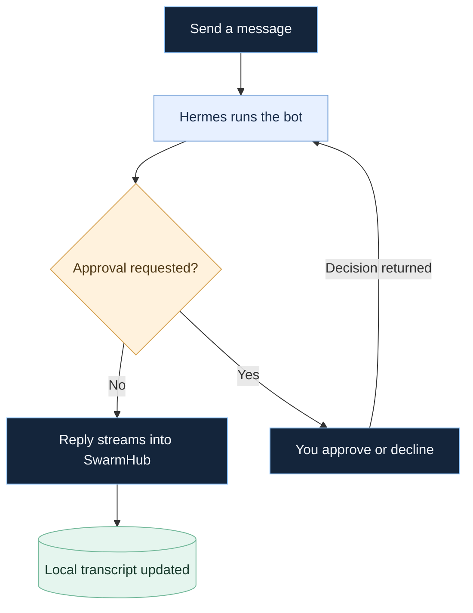

# SwarmHub guide

Setup instructions, diagrams, and development notes. [Back to the overview](../README.md).

[Get started](#get-started) · [How it works](#how-it-works) · [Project status](#project-status) · [Technical reference](reference.md)

## Get started

To run the current macOS prototype, you’ll need **macOS 14+**, **Xcode 16.2**, and **Swift 6**. In Terminal on your Mac:

```bash
git clone https://github.com/conrader/swarmhub.git
cd swarmhub
./scripts/run.sh
```

The run script builds and launches the app.

### Connect Hermes

1. On first run the setup window asks for your Hermes server’s address and key, tests them and lets you pick its agents. Later: **Settings → Change connection…**.
2. To enter them by hand, open **Settings → Advanced… → Servers and keys**, fill in the base URL and key, and use **Test & Discover**.
3. For named profiles, use **Add bots from box** (same pane) with one `profile=key` per line. Each profile needs its own key.

Need to set up the server first? Follow the [Hermes setup notes](reference.md#hermes-agent-setup). For imports, see [Grok Bot history](reference.md#feature-parity) and [bot templates](reference.md#grok-bot-template-import).

The sidebar puts conversations with the latest sent or received messages first. Click a bot under “On this box · not connected” to view its connection options or delete it; Delete is also in the row’s right-click menu. Deleting removes its entry from SwarmHub and keeps the bot on your box. To bring it back, use **Settings → Advanced… → Servers and keys → Add all bots from this box**.

### macOS shortcuts

| Shortcut | Action |
|:--|:--|
| `⌘ K` | Open the quick switcher (↑/↓ move, Return opens, Esc closes) |
| `⌘ N` | Create an agent |
| `⌃ ⌘ S` | Toggle the sidebar |
| `⇧ ⌘ I` | Toggle the info panel |

## How it works

SwarmHub is the desktop workspace. Your Hermes server runs the agents, connects to configured models, and provides each profile’s tools and skills.


### From message to reply

With the default **Ask me** policy, approval requests come to you in SwarmHub. Approved operations can proceed; declined operations are denied.



### Messages waiting to be sent

Typing while a bot answers never stops the answer: the message steers it, or, when the bot's server cannot steer (or the message has attachments), it waits and goes when the answer ends. A steer that could not be delivered offers **Send as next message**, and a review card offers to send its notes; both wait until the running answer ends. Waiting messages survive a quit: when SwarmHub reopens they resume in order once your server has been checked. If an earlier reply is still unconfirmed, or the waiting text changed, the message is not sent; a line says why and its button returns, so you can **Refresh** that reply and send it again. A group round the quit interrupted keeps its finished replies; members not yet asked show **Retry**.

### Coordinate work across bots

In a group, choose **Plan a workflow**, write the request and pick a coordinator. The coordinator proposes tasks and assignments; nothing runs until you choose **Approve plan and run**. Each task runs in its own thread, one after another, and the coordinator posts one consolidated answer in the group.

While working, an agent can ask another member for help or for a review, and the coordinator can assign more work. A help request adds a helper task and then a continuation for the original agent. A review can ask for one revision followed by a second review. New tasks pause the workflow until you review the expanded plan; work already sent may finish. Expand a workflow to see each task's input, result, dependencies, review round and verdict, and the handoff history.

If the second review still finds problems, the final answer waits. Read the findings, then choose **Accept review with noted limitations** or **Cancel workflow**; accepting keeps the findings and tells the final answer about your decision. A reviewer that finishes without a verdict needs the same decision. **Refresh from server** checks a task whose completion is uncertain without sending it again; a task that certainly was not sent can be sent again or given to another member.

A workflow allows 12 tasks, three handoff levels, two review rounds per piece of work and 30 minutes. The token allowance limits further sending; it counts the hidden handoff and tool exchanges too, estimated where your server reports no usage, so it is not a billing cap. After a restart, unfinished tasks wait for **Refresh** and the workflow stays paused until you resume it.

## Project status

**This is a prototype.** Windows and Linux versions are planned. Hermes and OpenClaw are implemented; the OpenClaw connection was built against the published protocol and a test Gateway, and still needs a check against a real Gateway. Interrupted replies are recovered from your server ([how](reference.md#never-losing-a-reply)), and coding threads use each agent's coding model.

Approvals default to **Ask me**. Rules and reviewer modes have known limitations, and provider-backed reviewer decisions remain unverified. Read the [known issues](reference.md#known-issues) before enabling automatic approvals.

The [roadmap](../PLAN.md) and [phase briefs](../briefs/) track the work ahead. The [technical reference](reference.md) documents feature behavior, compatibility, and verification limits.

## Build & contribute

```bash
./scripts/build.sh   # Build the app
swift test           # Run the test suite on a Mac
```

The build script includes a direct-compiler fallback for the documented Xcode 16.2 toolchain issue; that fallback does not run tests. See the [build notes](reference.md#build-and-run) for details.

The current macOS implementation uses SwiftUI, atomic JSON persistence, and backend adapters under `Sources/AgentApp/`. The Swift package and executable retain the `AgentApp` codename. See [architecture](reference.md#architecture), [integration notes](hermes-integration.md), and the [project constraints](../PLAN.md#standing-constraints-from-briefmd-and-spec-61).
