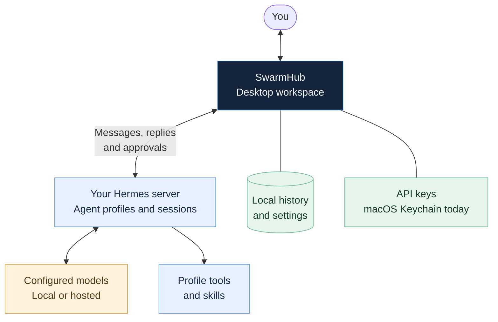
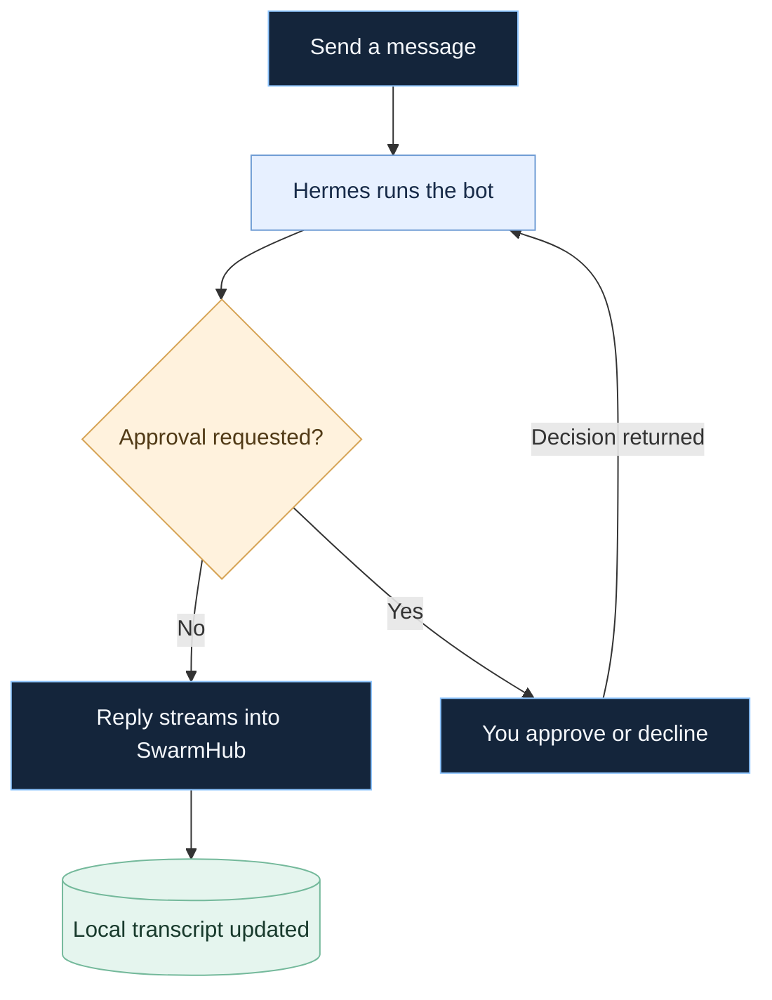

# SwarmHub guide

Setup instructions, diagrams, and development notes. [Back to the overview](../README.md).

[Get started](#get-started) · [How it works](#how-it-works) · [Project status](#project-status) · [Technical reference](reference.md)

## Get started

To run the current macOS prototype, you’ll need **macOS 14+**, **Xcode 16.2**, and **Swift 6**. In Terminal on your Mac:

```bash
git clone https://github.com/conrader/swarmhub.git
cd swarmhub
./scripts/run.sh
```

The run script builds and launches the app.

### Connect Hermes

1. Open **Settings → Account** and enter your Hermes server’s base URL and API key.
2. Use **Test & Discover** to check the connection.
3. For named profiles, use **Add bots from box** with one `profile=key` per line. Each profile needs its own key.

Need to set up the server first? Follow the [Hermes setup notes](reference.md#hermes-agent-setup). For imports, see [Grok Bot history](reference.md#feature-parity) and [bot templates](reference.md#grok-bot-template-import).

### macOS shortcuts

| Shortcut | Action |
|:--|:--|
| `⌘ K` | Open the quick switcher |
| `⌘ N` | Create a bot |
| `⌃ ⌘ S` | Toggle the sidebar |
| `⇧ ⌘ I` | Toggle the info panel |

## How it works

SwarmHub is the desktop workspace. Your Hermes server runs the agents, connects to configured models, and provides each profile’s tools and skills.



### From message to reply

With the default **Ask me** policy, approval requests come to you in SwarmHub. Approved operations can proceed; declined operations are denied.



## Project status

**This is a prototype.** Windows and Linux versions are planned. Hermes is the implemented backend; OpenClaw currently has configuration and an adapter boundary, with its WebSocket transport still to come. More reliable recovery of interrupted turns and coding threads are planned.

Approvals default to **Ask me**. Rules and reviewer modes have known limitations, and provider-backed reviewer decisions remain unverified. Read the [known issues](reference.md#known-issues) before enabling automatic approvals.

The [roadmap](../PLAN.md) and [phase briefs](../briefs/) track the work ahead. The [technical reference](reference.md) documents feature behavior, compatibility, and verification limits.

## Build & contribute

```bash
./scripts/build.sh   # Build the app
swift test           # Run the test suite on a Mac
```

The build script includes a direct-compiler fallback for the documented Xcode 16.2 toolchain issue; that fallback does not run tests. See the [build notes](reference.md#build-and-run) for details.

The current macOS implementation uses SwiftUI, atomic JSON persistence, and backend adapters under `Sources/AgentApp/`. The Swift package and executable retain the `AgentApp` codename. See [architecture](reference.md#architecture), [integration notes](hermes-integration.md), and the [project constraints](../PLAN.md#standing-constraints-from-briefmd-and-spec-61).
