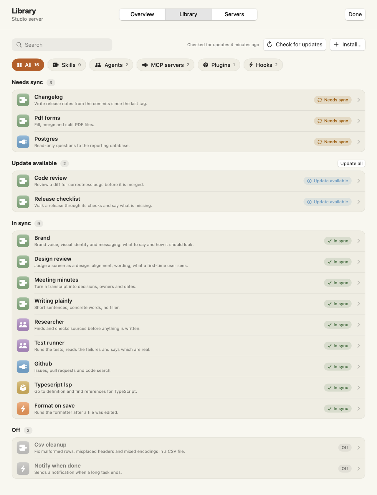

# SwarmHub guide

How to set up the Mac app and use it. The app chats with agents that Herdr Core runs. It reaches them through the SwarmHub bridge, a service that runs beside Herdr Core on the same machine.

The app uses plain words for these parts, and so does this guide where it quotes the app. A bot's agent program is its **AI** and goes by a short name ("Claude", "Codex"). The bridge is "the SwarmHub service" in the setup window and "the workspace" in Software Update.

<a id="how-it-works"></a>

## How it works

<picture>
  <source media="(prefers-color-scheme: dark)" srcset="diagrams/overview-dark.svg">
  
</picture>

A bot in the app is one agent on a Herdr server: an agent program such as Claude Code or Codex, running in a terminal there. Your message goes from the app to the bridge, Herdr Core types it into the agent, and the reply comes back as it is written. [Architecture](architecture.md) has the details.

## Get started

### 1. Decide where your bots work

Bots work on a computer that runs two programs: Herdr Core, which keeps each bot's AI program running, and the SwarmHub service (the bridge), which the app talks to. That computer is this Mac or a server.

**This Mac.** You install nothing by hand. Choose **This Mac** in the setup window and press **Set Up This Mac**; [This Mac](#this-mac) says what that does. You need at least one AI program on the Mac that you have signed in to, such as Claude Code or Codex.

**A server.** The app does not install anything on a server yet. Follow [Run locally](../HerdrWorkspace/README.md#run-locally) there: `swarmhub-herdr service run` starts an installed service, starts Herdr Core when it is not running, and keeps the access key in `~/.config/swarmhub-herdr/token`, which is where the app looks for it. Herdr Core needs at least one agent template, for example for Claude Code or Codex. An AI program asks a person a question the first time it works in a new folder; `swarmhub-herdr service prepare` on the server answers those for the bots' folder ([what it does](#what-setting-up-this-mac-does), under the switch), or open each program once in that folder and answer yourself.

### 2. Start the app

Build and run from a checkout on a Mac with Xcode:

```sh
./scripts/run.sh
```

The packaged build is on the [releases page](https://github.com/conrader/swarmhub/releases). From 0.8.0 on it is the app this guide describes. Versions up to 0.6.8 are the earlier app, from before it moved to Herdr Core; their bots do not carry over.

### 3. Connect

The setup window opens while there is no bot. Later, open it from the quick switcher (⌘K): **Set up…**, or **Add a server…** once every server has its main bot. The empty main window has a **Set up** button too.

<picture>
  <source media="(prefers-color-scheme: dark)" srcset="screenshots/dark/setup-where.png">
  
</picture>

The screens in this guide are rendered by the app with sample content.

1. **Where.** Choose **This Mac** or **A server**, which the app reaches with your SSH login. **Advanced** holds a third way, **A server by address**, for a server whose port you already forwarded to this Mac. "Get a ready-made server from us" is marked "Coming soon" and cannot be chosen.
2. **Connect.** This Mac needs nothing typed and is checked as soon as you press **Continue**; when it is not set up yet, the window says what it will install and the button reads **Set Up This Mac** ([This Mac](#this-mac)). For a server, give the server's name and, if needed, a login name and the path of an SSH key file, then press **Connect**; a key with a passphrase must already be unlocked (`ssh-add`). For a server by address, give the address and the access key. **Connection details** holds what few people type: the access key (the app finds it by itself on this Mac and over SSH), the port, and a name for the server. When the check fails, the window says what is wrong and the button reads **Try again**.
3. **Main bot.** Create the server's main bot: an avatar, a name, an **AI** and a **Model**. Or choose a bot that is already on that server. Instructions are added later, in the bot's settings.
4. **More bots.** Optionally choose a bot for each other AI the server has.
5. **Projects.** Optional, and only on a server that can add project servers. If your projects are on another server, add it here and name a first project; see [Projects on other servers](#projects-on-other-servers). To skip it, press the last button.

The window ends in the main bot's chat.

To look around without a server, close the setup window and choose **Look around with sample bots** in the main window. The sample bots answer locally.

More detail on the ways to connect: [Use the Mac app](../HerdrWorkspace/README.md#use-the-mac-app), and the drawing under [Where bots run](architecture.md#where-bots-run).

<a id="the-first-conversation"></a>

### 4. Say hello

A main bot that the setup window has just created opens the conversation itself. The chat shows one small line, "SwarmHub asked Jarvis to say hello" (with your bot's name), and the bot greets you, says what it can do, and asks a few short questions, one per reply:

1. what to call you,
2. what you work on,
3. what you would like help with first,
4. whether it should set up other bots for that,
5. whether any of your projects are on another server.

You can skip any question or stop whenever you like. The bot is told to do no other work until you ask for something.

When an answer tells the bot something lasting about you, a card above the composer says "Jarvis would like to remember this about you", with **Remember** and **Don’t save**. What you keep goes into **About you**, a short text (up to 800 characters) that every bot is given with its instructions, so no bot has to ask again. Read and edit it under **Settings → General**. Only a main bot suggests additions, and nothing is added without your OK.

A main bot that the setup window did not create (one from before, or one you chose to keep) offers this once, above its composer: "Let Jarvis get to know you", with **Start** and **Not now**. To ask for it later, choose **Get to know me** in the **+** menu of the main bot's composer.

## This Mac

Choose **This Mac** in the setup window and your bots work on the Mac you are sitting at. The first time, the window lists what it will install and waits for **Set Up This Mac**. Nothing is installed before you press it.

### What setting up this Mac does

1. **Fetches the SwarmHub service** for this Mac's processor (Apple silicon or Intel) from the SwarmHub release, and checks it against the release key the app carries before it is used. A download that is not the signed release is thrown away. The program goes to `~/.local/bin/swarmhub-herdr`.
2. **Installs Herdr Core** when it is not on the Mac yet: from Herdr's own releases, and only a build that Herdr signed with its Apple developer identity. A Herdr Core that is already there is used as it is.
3. **Makes an access key** for the app (`~/.config/swarmhub-herdr/token`, readable by you only) and a folder for your bots' work, `swarmhub-agents` in your home folder.
4. **Writes a starter template** for each AI program it finds on the Mac (Claude Code, Codex), in Herdr Core's templates folder (`~/.config/herdr-core/templates/swarmhub-claude.md`, `swarmhub-codex.md`), and a starter list of models. It installs no AI program and signs in to none.
5. **Starts the service and keeps it running**: a background item of your account (`~/Library/LaunchAgents/com.konrad.agentapp.service.plist`) starts it now, at every login, and again if it stops. macOS shows a "Background Items Added" notice. Your bots keep working while the app is closed.

**Answer my AIs' first questions for me** is a switch in the same window, on unless you turn it off. An AI program asks a person two things the first time, in a window no chat shows, so a bot's first message would wait forever:

- Claude Code asks whether it may work in a new folder. With the switch on, SwarmHub tells Claude Code to trust the bots' folder, and only that folder: one entry in Claude Code's own settings file, `projects["<your home>/swarmhub-agents"].hasTrustDialogAccepted` in `~/.claude.json`, which is the entry Claude Code's documentation names for doing this by hand. Everything else in that file stays exactly as it was, and a copy of the file as it was is kept beside it (`~/.claude.json.before-swarmhub`). In a folder it trusts, Claude Code also uses settings files it finds there.
- Codex asks to review the three commands SwarmHub gives it to show its steps and save its replies. With the switch on, the service tells Codex at each start that exactly those three commands are trusted. Nothing is written into Codex's settings.

Nothing else is answered for you: an AI's questions about running a command or changing a file stay yours, and no permission or sandbox setting is changed. If a program's settings are not in a form SwarmHub knows, it changes nothing and the setup window shows the question under **Your AIs** with **Answer in Terminal**.

When the Mac is ready the window shows **Your AIs**: each AI is started once with no task (no model is used) to see that it can take a message.

### What you need

- macOS 14 or later, and an internet connection for the setup.
- At least one AI program that you have opened once in Terminal and signed in to. Without one the window says so and how to get one.
- Port 8787 free on the Mac, or another port chosen under **Connection details**.

### Updating it

**Settings → Software Update** lists This Mac with your servers: its version, **Update** when a newer service is published, and **Go Back**. An update is checked and tried the same way as on a server, and your bots' AI programs keep running through it ([Updates](updates.md)).

### Removing it

**Settings → Servers → This Mac → Advanced → Stop and Remove…** ends your bots' running AI programs, stops the service, removes the background item, the starter templates it wrote, the access key and the program, and takes back what it told Claude Code and Codex to trust. It keeps your conversations (`~/.local/state/swarmhub-herdr`), your bots' files (`~/swarmhub-agents`) and Herdr Core, which other apps may use. The same from Terminal: `~/.local/bin/swarmhub-herdr service remove`.

## Everyday use

### Chat

Type a message and send it. The reply appears as the bot writes it, with each tool call as a step under it. Until there is text, the line under the reply says what it is waiting for: the AI is starting, the bot is working, a tool step is running, or the bot is waiting for you in its terminal.

Opening a chat starts that bot if it is not running, so the first reply does not wait for the AI to start. The header says **Starting …** and then **Ready**; **Ready** means a reply starts at once. You can write while it starts: the message is delivered as soon as the bot is ready. To turn this off for one bot, open its Details, **Model**, **Advanced**, and switch off **Keep _name_ ready**.

- **Stop** in the composer (**Chat → Stop Answer**, ⌘.) interrupts the answer. The bot stays open for the next message.
- A message you send while the bot answers goes into the running answer. If **Read new messages mid-answer** is off for the bot (Details, **Model**, **Advanced**), or the message has attachments, it waits and is sent when the answer ends.
- A row marked as not sent offers **Retry**.

<a id="change-a-model"></a>

### Change what a bot runs on

Open the bot's Details (⇧⌘I) and choose **Model** (⌘6). Pick the **AI** and the **Model**; both lists come from the server. A change applies the next time the bot starts. **Start fresh** makes it start over now on what you chose: the chat stays, and the bot forgets what was said in it. A bot that was started when you opened the chat and has not been written to yet is switched at once.

**New bots run on**, in **Settings → Servers**, chooses the AI that new bots start on.

### Bot settings

**Chat → Bot Settings…** (⌥⌘,) has the bot's avatar, name, instructions and **Notify me when it replies**. **Advanced** holds its role, **Main bot**, **Ask me before creating bots** (for a main bot), **Other bots can message it**, **Can use helpers**, and the projects it may use. What a bot runs on is in its Details, not here.

### Create more bots

- **File → New Bot…** (⌘N), or **+** at the top of the sidebar, creates a bot yourself.
- Ask the server's main bot for one; **New bot…** in the **+** menu of its composer starts the request for you. The main bot creates the bot or asks you first. A bot it suggests shows above the composer with **Create** and **Not now**. A bot it created by its own decision shows there with **Keep** and **Remove**.
- **Add a bot for each AI**, in **Settings → Servers → Connection**, adds one bot for each AI the server has that no bot uses yet.

### Bots that write to each other

A bot can write to another bot on its server by name. The app puts the message into that bot's chat as a card with the sender's face, and the reply back into the sender's chat, so you can read both sides. This happens while the app runs. Limits keep two bots from answering each other for ever; at a limit the bots are told to bring the matter to you. To stop a bot from getting such messages, turn off **Other bots can message it** in its settings, under **Advanced**. **Stop** in a bot's chat ends the exchanges it is part of.

### Helpers

A bot can hand parts of its work to helpers. They show under the bot in the sidebar while they run; select one to read its task, steps, replies and terminal. To choose what each difficulty runs on, open **Settings → Servers**, choose the server, then **Helpers**. To stop one bot from using helpers, turn off **Can use helpers** in its settings, under **Advanced**.

<picture>
  <source media="(prefers-color-scheme: dark)" srcset="screenshots/dark/helpers-sidebar.png">
  
</picture>

### Skills

What your bots know how to do is kept in a library on the server. A separate program there, [skillshare](https://skillshare.runkids.cc), looks after it. The library holds five kinds of things:

- **Skills**: instructions a bot follows for one kind of job.
- **Agents**: ready-made helpers a bot can hand a job to.
- **MCP servers**: outside tools and services a bot can use.
- **Plugins**: add-ons for the AI program itself.
- **Hooks**: small commands the AI program runs at set moments.

A sync brings the library to the AI programs on that server, and through them to your bots. The library belongs to the server, so every bot on it shares it. A bot picks up a change the next time it starts fresh.

**Settings → Servers → Skills** and the **Skills** tab of a bot's Details (⌘7) say where the library stands: that everything is in sync, or how many changes are waiting, with one **Sync now** button. The tiles count what is in it. **Open library** opens the whole library, in three parts.

<picture>
  <source media="(prefers-color-scheme: dark)" srcset="screenshots/dark/skills.png">
  
</picture>

**Overview** repeats that summary, lists each AI the library is shared with and what is waiting for it, and offers **Share with another AI…**. Sharing asks first: from then on that AI gets your library in every session on the server, including the ones you start yourself. If a part of the library could not be read, the Overview says which part and why, and does not call the library in sync.

**Library** lists everything, grouped by where it stands: Needs sync, Update available, In sync and Off. Choose a kind at the top, or search. Click a thing to read it:

- A skill shows its instructions as a page, with its other files to choose from. An agent shows its file.
- An MCP server, a plugin or a hook shows its settings. Passwords and keys stay on the server: you see only their names.
- Every thing shows which AIs have it and which are waiting for it.

<picture>
  <source media="(prefers-color-scheme: dark)" srcset="screenshots/dark/skills-library.png">
  
</picture>

**Servers** shows skillshare on each of your servers: its version, whether the AIs there are in sync, the state of the library's repository, and anything skillshare warns about. When a newer skillshare is out, **Update skillshare…** installs it after you confirm.

#### Turn things on and off

Open a skill, an agent or a hook and use its switch. The app changes the library and then syncs, so your bots get the change. If the sync fails, the app says that the change is in the library and your bots do not have it yet; **Sync now** tries again. MCP servers and plugins have no switch.

#### Install skills

In **Library**, choose **Install…** and name a repository, such as `owner/repo`. The server downloads it and checks every skill in it. Nothing is installed yet, and nothing from the download is run. You then see each skill with the result of the check:

- A skill that passed is ticked. One the library already has is marked **Replaces the one you have**.
- A skill the check blocked is left out, and you see what was found: how serious it is, in which file and line, and the line itself. **Install anyway…** asks first. A skill installed this way stays exactly at the version that was checked until you install it again.
- **Ask a bot to review** sends the findings to a bot you pick. It is told to read and report, not to install. Its answer comes in its chat.

**Install** installs what is ticked and syncs. **Cancel** removes the download from the server.

#### Update and remove

The library looks for newer versions when you open it, at most every ten minutes, and when you choose **Check for updates**; this can take a minute. Things with a newer version are listed under **Update available**: open one and choose **Update**, or use **Update all**. If the security check refuses a new version, that thing stays as it is and the app says so.

**Remove…** asks first. A removed skill, agent or hook goes to skillshare's trash on the server for 7 days. **Show changes** shows what a sync would change in a thing, line by line.

#### The library's repository

If the library is kept in a Git repository, the bottom of the Overview says how the two compare, for example “3 changes not saved to the repository, 2 to pull”. **Pull** brings the repository's changes to the server. **Commit and push…** saves the server's changes and sends them to the repository, and **Sync both ways…** does both; each asks first, because others who use the repository get what you send. If the same file changed in both places, nothing is changed: you see both versions side by side, choose one for each file, and confirm.

#### A project's own library

A project folder on the server itself can have a library of its own. When one of a bot's projects has one, the bot's **Skills** tab offers **Which library**: the one all bots on the server share, or that project's.

#### Older servers

A server that has not been updated yet shows its skills as a list of switches, as before, and says that an update brings the full library. Update it under **Settings → Software Update**. A server without skillshare says so.

#### What the app leaves to the server

Use `skillshare` on the server to add or change MCP servers, plugins and hooks, to follow a whole repository, to install agents from a repository, to bring something back from the trash, to back up and restore, and to change how an AI program receives the library. The library is about the server your bots run on; skillshare on your project servers is not shown.

### Projects on other servers

Your projects may live on other servers than the one your bots run on. Open **Settings → Servers**, choose the server your bots run on, then **Projects**, and press **Add a server**.

1. Copy the line the app shows and paste it into `~/.ssh/authorized_keys` of the account on the project server.
2. Type the SSH address (such as `deploy@10.0.0.7`) and a short name, and press **Add server**.
3. The first time, the app shows the server's fingerprint. Compare it with the server's own (`ssh-keygen -lf /etc/ssh/ssh_host_ed25519_key.pub` on that server) and press **Trust this server**.
4. Press **Add its first project** (later **Add a project**) and give a name and the folder.

Then open a bot's settings, **Advanced**, or the **Overview** tab of its Details, and switch on the projects it may use. The bot can run commands and change files in those folders, so choose with care.

### Groups

**File → New Group…** (⇧⌘N) puts several bots in one thread. Write `@Name` to address one member; a message without a mention goes to every member.

<a id="files-and-voice"></a>
<a id="files"></a>

### Files

Drop or attach images, text files, PDF, RTF, DOC or DOCX files. Text and document contents reach the bot as text. Images are kept in the chat and are not sent to the bot.

### Import from Grok Bot

When Grok Bot is on this Mac, **Settings → Servers** shows a **Grok Bot** card. **Import from Grok Bot…** there, or in the **+** menu at the top of the sidebar, reads Grok Bot's bots and history on this Mac. Each bot becomes a bot here with its old history as a read-only archive.

### More servers

**Settings → Servers → Add a server** adds another server: choose where it is, fill in its fields and press **Connect and add**. Each bot runs on one server. With more than one server, a bot's Details show **Server** under **Model**, **Advanced**.

### Updates

**Settings → Software Update** answers whether everything is up to date: the app, and for each server its workspace (the bridge) and Herdr Core. When something is behind, a line appears at the bottom of the sidebar, and the page has one button, **Update Now** or **Update All**, that installs what is ready: the servers first, then the app.

- The app updates through Sparkle. It checks once a day in the background; **Install updates automatically** is off unless you turn it on. An app run from source does not update itself.
- A server installs a new workspace itself, from a signed release. Only the workspace restarts; your bots keep running.
- Herdr Core is updated by Herdr's own updater, started from the server's ••• menu.

How this works, what is trusted, and the one-time install by hand on a server whose workspace cannot update itself yet: [Updates](updates.md).

## Keyboard shortcuts

| Shortcut | Action |
| --- | --- |
| ⌘, | Settings |
| ⌘N | New Bot |
| ⇧⌘N | New Group |
| ⇧⌘O | Import Template |
| ⌘K | Quick Switcher |
| ⌃⌘S | Show or Hide Sidebar |
| ⇧⌘I | Show or Hide Details |
| ⇧⌘H | Show or Hide Hidden Chats |
| ⌘1, ⌘6, ⌘7, ⌘3 | Details: Overview, Model, Skills, Media |
| ⌘5 | Members, in a group |
| ⌥⌘↑, ⌥⌘↓ | Previous Chat, Next Chat |
| ⌥⌘, | Bot Settings |
| ⌘. | Stop Answer |
| ⌘/ | Keyboard Shortcuts |
| Return, ⇧Return | Send the message, start a new line |

## When something is wrong

- **"SwarmHub installs what your bots need to run here."** Nothing answers on this Mac yet. Read what will be installed and press **Set Up This Mac** ([This Mac](#this-mac)).
- **"This Mac could not be set up."** The line under it says why: no internet connection, a release that was not signed with the SwarmHub release key (it is not used), or "Another program on this Mac already uses port 8787" (open **Connection details**, choose another port, try again).
- **"No AI program was found on this Mac."** Install Claude Code or Codex, open it once in Terminal and sign in, then press **Try again**.
- **An AI "has a question for you".** The AI program is asking something in its own window that SwarmHub did not or could not answer for you. Press **Answer in Terminal**, answer it there, close the window, and press **Check Again**.
- **The access key is refused.** The key in the app is not the one the bridge runs with. Empty the access key field so the app reads the key again, or paste the current one. The field is under **Connection details** in the setup window and under **Advanced** in **Settings → Servers → Connection**.
- **The bridge answers without Herdr Core.** Start Herdr Core on that machine.
- **The server has no AI to start.** Add an agent template to Herdr Core.
- **A reply never arrives.** The bot may be waiting at a prompt in its terminal; the chat header then says **Waiting for you in its terminal**. Answer it in the browser workspace or with `hc attach`.
- **"This server needs an update."** Open **Settings → Software Update**. A server whose workspace cannot update itself yet needs one install by hand: [First install on a server](updates.md#first-install-on-a-server).

<a id="build--contribute"></a>

## Build and contribute

See the [technical reference](reference.md) for the build, and [Architecture](architecture.md) for how the parts fit together.
