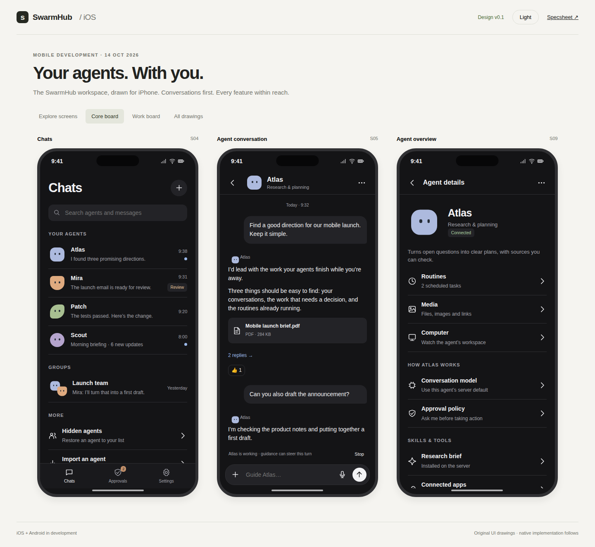

# SwarmHub mobile development

The iOS and Android apps are in development. The first native iOS foundation now lives in [Apps/iOS](../../Apps/iOS/README.md), with shared Swift code in [Packages/SwarmHubCore](../../Packages/SwarmHubCore/README.md). It includes secure profile setup, server sessions, cached history/drafts, streaming text chat and manual approvals. The drawings below describe the full feature target; store distribution and the remaining feature milestones follow.

- [iOS specsheet](specsheet.md): scope, feature parity, screen inventory, architecture, acceptance criteria, and implementation milestones.
- [Interactive screen drawings](screens.html): 37 screens with navigation, light and dark appearances, and local sample interactions. Open the file in a browser; no server or installation is needed.
- [Core screens](core-screens.png): chats, conversation, agent overview, routines, approvals, and settings.
- [Work screens](work-screens.png): group chat, thread, media, computer, models, and import preview.
- [Screen index and flows](screen-map.md): destinations and backend dependencies.

All content is synthetic. The drawings make no API calls and never connect to an agent, save a key, send a message, or grant an approval. Labels for future server features appear in the screens that require them.

The iOS design uses SwarmHub's agent marks, quiet chat layout, and dark default. The desktop side panel becomes agent details on iPhone. Android will follow the same feature and backend contract with Android navigation and controls; its native implementation and dedicated screen drawings follow the iOS foundation.

## Inspect the drawings

Open `screens.html`, choose a screen in the index, and follow the controls inside the phone. Select **All drawings** for the full screen board or **Core board** and **Work board** for the exported layouts. The **Light / Dark** control changes the product appearance. Browser back and a copied URL hash restore the selected screen.

Screen sources are split into `screens-core.js`, `screens-work.js`, and `screens-settings.js`, with reusable UI in `ui.js`, navigation in `prototype.js`, and appearance in `screens.css`. Exported PNGs are browser captures of these drawings, not captures of a running iOS app.

[Drawing verification](qa/verification.json) covers all 37 screens at 390 px and 1440 px in light and dark appearances, route availability, and selected local interactions. [Native verification](native-verification.md) records the build/fixture results and remaining simulator/device checks separately.

## Sources

The specification follows the current [SwarmHub technical reference](../reference.md), [desktop roadmap](../../PLAN.md), and backend adapter code. Product comparisons use the official [Grok Bot overview](https://prod.cursor.com/docs/grok-bot) and [workflows](https://prod.cursor.com/docs/grok-bot/work). Mobile lifecycle decisions follow Apple's [background execution guidance](https://developer.apple.com/documentation/backgroundtasks/choosing-background-strategies-for-your-app) and [background push guidance](https://developer.apple.com/documentation/usernotifications/pushing-background-updates-to-your-app).
